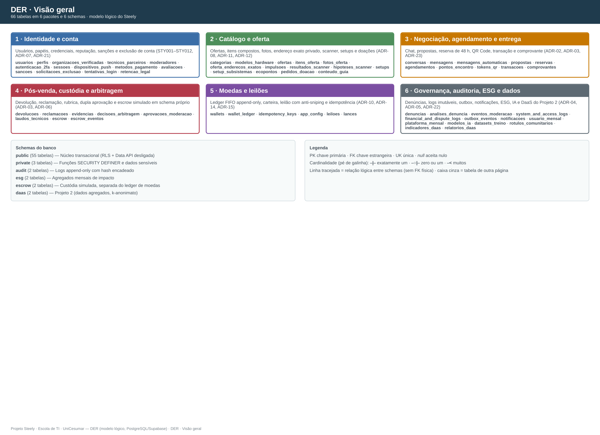
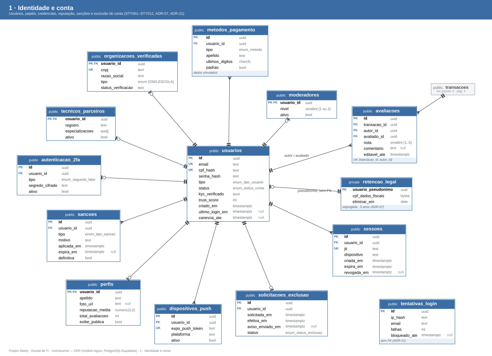
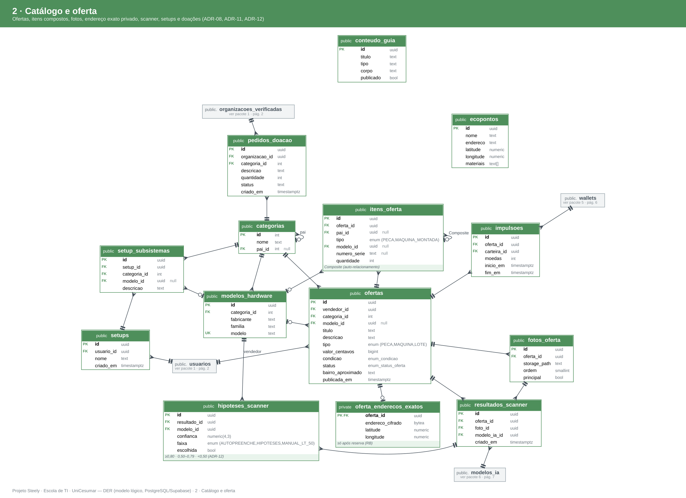
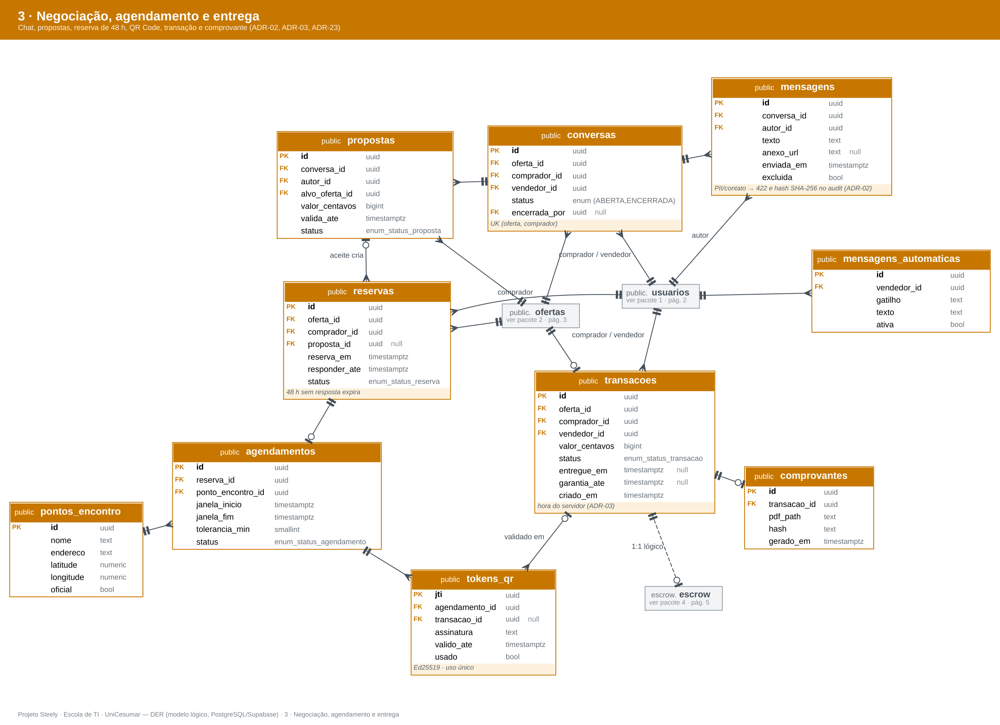
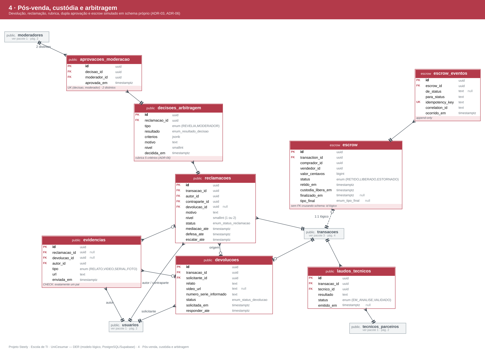
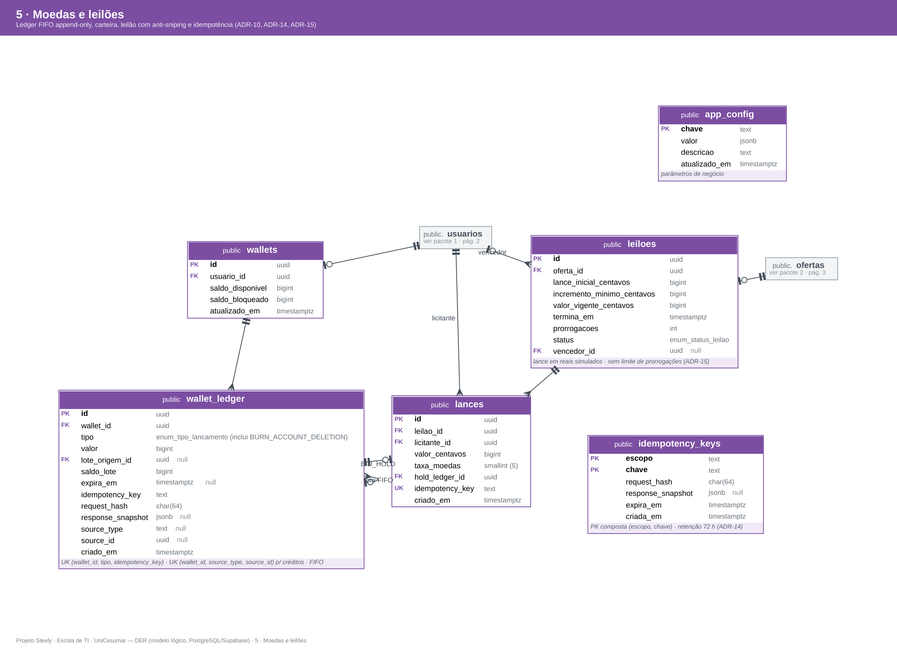
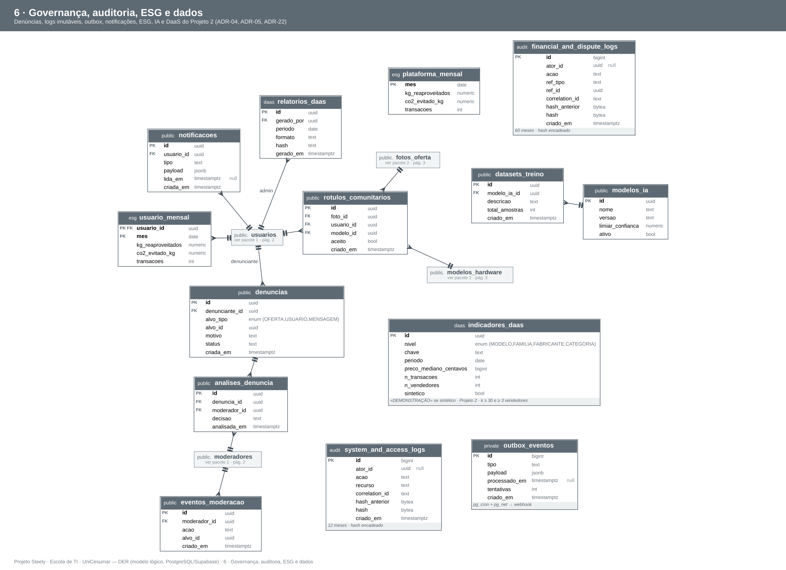
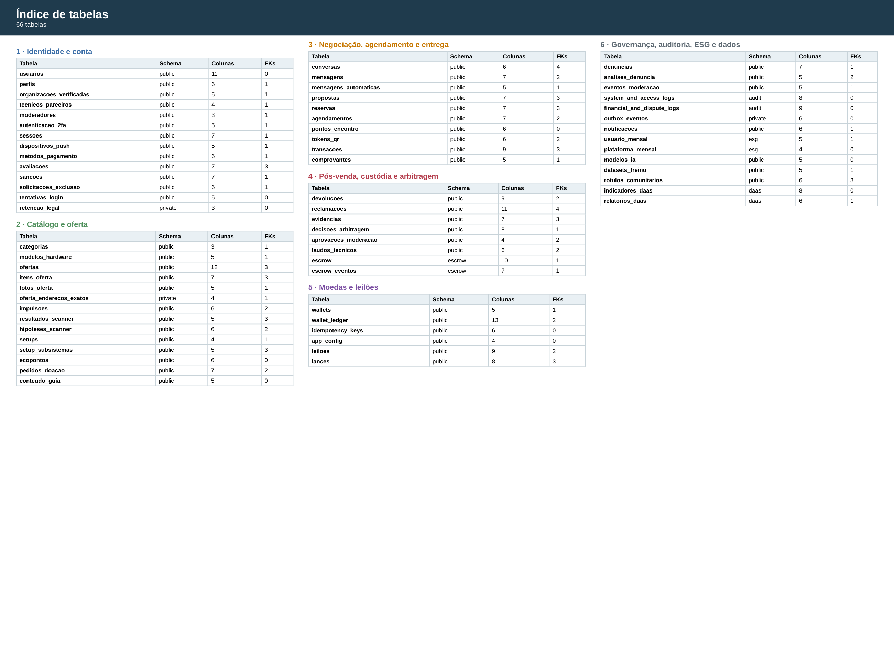

# Diagrama Entidade-Relacionamento (DER) — Modelo Lógico Steely

> **Arquivo Original em PDF:** [`originais/DER_Steely.pdf`](originais/DER_Steely.pdf)  
> **Banco de Dados:** PostgreSQL 15 (Supabase Core + Projeto 2 DaaS Isolado — `ADR-04`, `ADR-08`)  
> **Escopo:** **66 tabelas** organizadas em **6 pacotes de domínio** e **6 schemas** (`public`, `private`, `escrow`, `audit`, `esg`, `daas`).

---

## Resumo de Schemas

| Schema | Qtd. Tabelas | Papel Arquitetural e Segurança (`ADR-03` a `ADR-10`) |
| --- | --- | --- |
| `public` | 55 tabelas | Núcleo transacional com RLS ativada e Data API (PostgREST) desligada (`ADR-08`, `ADR-09`). |
| `private` | 3 tabelas | Tabelas sensíveis e operacionais (`retencao_legal` por 5 anos, `oferta_enderecos_exatos` sob `RB-06` e `outbox_eventos` do `pg_cron`) + funções `SECURITY DEFINER`. |
| `escrow` | 2 tabelas | Custódia financeira simulada em centavos (`escrow.escrow` e `escrow.escrow_eventos`), separada do ledger de moedas (`RB-09`, `ADR-03`). |
| `audit` | 2 tabelas | Trilha de auditoria imutável *append-only* com hash encadeado: `system_and_access_logs` (12 meses) e `financial_and_dispute_logs` (60 meses) (`ADR-05`). |
| `esg` | 2 views/tabelas | Agregados mensais de impacto ambiental (`usuario_mensal` e `plataforma_mensal` com `k ≥ 30`) (`ADR-22`). |
| `daas` | 2 tabelas | Banco isolado no Projeto Supabase 2 (`indicadores_daas` com `k ≥ 30` transações, `≥ 3` vendedores e flag `sintetico`, e `relatorios_daas`) (`ADR-04`). |

---

## 1. Visão Geral — 66 Tabelas em 6 Pacotes e 6 Schemas



<details>
<summary>📄 Ver especificação textual completa das tabelas desta página (Página 1)</summary>

```text
DER · Visão geral
1 · Identidade e conta
Usuários, papéis, credenciais, reputação, sanções e exclusão de conta (STY001–STY012,
ADR-07, ADR-21)
usuarios · perfis · organizacoes_verificadas · tecnicos_parceiros · moderadores ·
autenticacao_2fa · sessoes · dispositivos_push · metodos_pagamento · avaliacoes ·
sancoes · solicitacoes_exclusao · tentativas_login · retencao_legal
2 · Catálogo e oferta
Ofertas, itens compostos, fotos, endereço exato privado, scanner, setups e doações (ADR-
08, ADR-11, ADR-12)
categorias · modelos_hardware · ofertas · itens_oferta · fotos_oferta ·
oferta_enderecos_exatos · impulsoes · resultados_scanner · hipoteses_scanner · setups
· setup_subsistemas · ecopontos · pedidos_doacao · conteudo_guia
3 · Negociação, agendamento e entrega
Chat, propostas, reserva de 48 h, QR Code, transação e comprovante (ADR-02, ADR-03,
ADR-23)
conversas · mensagens · mensagens_automaticas · propostas · reservas ·
agendamentos · pontos_encontro · tokens_qr · transacoes · comprovantes
4 · Pós-venda, custódia e arbitragem
Devolução, reclamação, rubrica, dupla aprovação e escrow simulado em schema próprio
(ADR-03, ADR-06)
devolucoes · reclamacoes · evidencias · decisoes_arbitragem · aprovacoes_moderacao ·
laudos_tecnicos · escrow · escrow_eventos
5 · Moedas e leilões
Ledger FIFO append-only, carteira, leilão com anti-sniping e idempotência (ADR-10, ADR-
14, ADR-15)
wallets · wallet_ledger · idempotency_keys · app_config · leiloes · lances
6 · Governança, auditoria, ESG e dados
Denúncias, logs imutáveis, outbox, notificações, ESG, IA e DaaS do Projeto 2 (ADR-04,
ADR-05, ADR-22)
denuncias · analises_denuncia · eventos_moderacao · system_and_access_logs ·
financial_and_dispute_logs · outbox_eventos · notificacoes · usuario_mensal ·
plataforma_mensal · modelos_ia · datasets_treino · rotulos_comunitarios ·
indicadores_daas · relatorios_daas
Schemas do banco
public (55 tabelas) — Núcleo transacional (RLS + Data API desligada)
private (3 tabelas) — Funções SECURITY DEFINER e dados sensíveis
audit (2 tabelas) — Logs append-only com hash encadeado
esg (2 tabelas) — Agregados mensais de impacto
escrow (2 tabelas) — Custódia simulada, separada do ledger de moedas
daas (2 tabelas) — Projeto 2 (dados agregados, k-anonimato)
Legenda
PK chave primária · FK chave estrangeira · UK única · null aceita nulo
Cardinalidade (pé de galinha): ⎯|⎯ exatamente um · ⎯○|⎯ zero ou um · ⎯< muitos
Linha tracejada = relação lógica entre schemas (sem FK física) · caixa cinza = tabela de outra página
66 tabelas em 6 pacotes e 6 schemas · modelo lógico do Steely
Projeto Steely · Escola de TI · UniCesumar — DER (modelo lógico, PostgreSQL/Supabase) · DER · Visão geral
```
</details>

---

## 2. Pacote 1 — Identidade e Conta (14 tabelas)



<details>
<summary>📄 Ver especificação textual completa das tabelas desta página (Página 2)</summary>

```text
1 · Identidade e conta
Usuários, papéis, credenciais, reputação, sanções e exclusão de conta (STY001–STY012, ADR-07, ADR-21)
public  autenticacao_2fa
PK
id
uuid
FK
usuario_id
uuid
 
tipo
enum_segundo_fator
 
segredo_cifrado
text
 
ativo
bool
public  usuarios
PK
id
uuid
UK
email
text
UK
cpf_hash
text
 
senha_hash
text
 
tipo
enum_tipo_usuario
 
status
enum_status_conta
 
kyc_verificado
bool
 
trust_score
int
 
criado_em
timestamptz
 
ultimo_login_em
timestamptz  
null
 
carencia_ate
timestamptz  
null
public  avaliacoes
PK
id
uuid
FK
transacao_id
uuid
FK
autor_id
uuid
FK
avaliado_id
uuid
 
nota
smallint (1..5)
 
comentario
text   null
 
editavel_ate
timestamptz
UK (transacao_id, autor_id)
autor / avaliado
public. transacoes
ver pacote 3 · pág. 4
public  dispositivos_push
PK
id
uuid
FK
usuario_id
uuid
UK
expo_push_token
text
 
plataforma
text
 
ativo
bool
public  metodos_pagamento
PK
id
uuid
FK
usuario_id
uuid
 
tipo
enum_metodo
 
apelido
text
 
ultimos_digitos
char(4)
 
padrao
bool
dados simulados
public  moderadores
PK FK usuario_id
uuid
 
nivel
smallint (1 ou 2)
 
ativo
bool
public  organizacoes_verificadas
PK FK usuario_id
uuid
UK
cnpj
text
 
razao_social
text
 
tipo
enum (ONG,ESCOLA)
 
status_verificacao
text
public  perfis
PK FK usuario_id
uuid
 
apelido
text
 
foto_url
text   null
 
reputacao_media
numeric(3,2)
 
total_avaliacoes
int
 
exibe_publica
bool
private  retencao_legal
PK
usuario_pseudonimo
uuid
 
cpf_dados_fiscais
bytea
 
eliminar_em
date
segregada · 5 anos (ADR-07)
pseudônimo, sem FK
public  sancoes
PK
id
uuid
FK
usuario_id
uuid
 
tipo
enum_tipo_sancao
 
motivo
text
 
aplicada_em
timestamptz
 
expira_em
timestamptz  
null
 
definitiva
bool
public  sessoes
PK
id
uuid
FK
usuario_id
uuid
UK
jti
text
 
dispositivo
text
 
criada_em
timestamptz
 
expira_em
timestamptz
 
revogada_em
timestamptz  
null
public  solicitacoes_exclusao
PK
id
uuid
FK
usuario_id
uuid
 
solicitada_em
timestamptz
 
efetiva_em
timestamptz
 
aviso_enviado_em
timestamptz  
null
 
status
enum_status_exclusao
public  tecnicos_parceiros
PK FK
usuario_id
uuid
 
registro
text
 
especializacoes
text[]
 
ativo
bool
public  tentativas_login
PK
id
uuid
 
ip_hash
text
 
email
text
 
falhas
int
 
bloqueado_ate
timestamptz  
null
sem FK (ADR-21)
Projeto Steely · Escola de TI · UniCesumar — DER (modelo lógico, PostgreSQL/Supabase) · 1 · Identidade e conta
```
</details>

---

## 3. Pacote 2 — Catálogo e Oferta (14 tabelas)



<details>
<summary>📄 Ver especificação textual completa das tabelas desta página (Página 3)</summary>

```text
2 · Catálogo e oferta
Ofertas, itens compostos, fotos, endereço exato privado, scanner, setups e doações (ADR-08, ADR-11, ADR-12)
public  categorias
PK
id
int
 
nome
text
FK
pai_id
int   null
pai
public  conteudo_guia
PK
id
uuid
 
titulo
text
 
tipo
text
 
corpo
text
 
publicado
bool
public  ecopontos
PK
id
uuid
 
nome
text
 
endereco
text
 
latitude
numeric
 
longitude
numeric
 
materiais
text[]
public  fotos_oferta
PK
id
uuid
FK
oferta_id
uuid
 
storage_path
text
 
ordem
smallint
 
principal
bool
public  ofertas
PK
id
uuid
FK
vendedor_id
uuid
FK
categoria_id
int
FK
modelo_id
uuid   null
 
titulo
text
 
descricao
text
 
tipo
enum (PECA,MAQUINA,LOTE)
 
valor_centavos
bigint
 
condicao
enum_condicao
 
status
enum_status_oferta
 
bairro_aproximado
text
 
publicada_em
timestamptz
public  hipoteses_scanner
PK
id
uuid
FK
resultado_id
uuid
FK
modelo_id
uuid
 
confianca
numeric(4,3)
 
faixa
enum (AUTOPREENCHE,HIPOTESES,MANUAL_LT_50)
 
escolhida
bool
≥0,80 · 0,50–0,79 · <0,50 (ADR-12)
public  modelos_hardware
PK
id
uuid
FK
categoria_id
int
 
fabricante
text
 
familia
text
UK
modelo
text
public  resultados_scanner
PK
id
uuid
FK
oferta_id
uuid
FK
foto_id
uuid
FK
modelo_ia_id
uuid
 
criado_em
timestamptz
public  impulsoes
PK
id
uuid
FK
oferta_id
uuid
FK
carteira_id
uuid
 
moedas
int
 
inicio_em
timestamptz
 
fim_em
timestamptz
public. wallets
ver pacote 5 · pág. 6
public  itens_oferta
PK
id
uuid
FK
oferta_id
uuid
FK
pai_id
uuid   null
 
tipo
enum (PECA,MAQUINA_MONTADA)
FK
modelo_id
uuid   null
 
numero_serie
text   null
 
quantidade
int
Composite (auto-relacionamento)
Composite
private  oferta_enderecos_exatos
PK FK
oferta_id
uuid
 
endereco_cifrado
bytea
 
latitude
numeric
 
longitude
numeric
só após reserva (RB)
public. usuarios
ver pacote 1 · pág. 2
vendedor
public  pedidos_doacao
PK
id
uuid
FK
organizacao_id
uuid
FK
categoria_id
int
 
descricao
text
 
quantidade
int
 
status
text
 
criado_em
timestamptz
public. organizacoes_verificadas
ver pacote 1 · pág. 2
public. modelos_ia
ver pacote 6 · pág. 7
public  setup_subsistemas
PK
id
uuid
FK
setup_id
uuid
FK
categoria_id
int
FK
modelo_id
uuid   null
 
descricao
text
public  setups
PK
id
uuid
FK
usuario_id
uuid
 
nome
text
 
criado_em
timestamptz
Projeto Steely · Escola de TI · UniCesumar — DER (modelo lógico, PostgreSQL/Supabase) · 2 · Catálogo e oferta
```
</details>

---

## 4. Pacote 3 — Negociação, Agendamento e Entrega (10 tabelas)



<details>
<summary>📄 Ver especificação textual completa das tabelas desta página (Página 4)</summary>

```text
3 · Negociação, agendamento e entrega
Chat, propostas, reserva de 48 h, QR Code, transação e comprovante (ADR-02, ADR-03, ADR-23)
public  agendamentos
PK
id
uuid
FK
reserva_id
uuid
FK
ponto_encontro_id
uuid
 
janela_inicio
timestamptz
 
janela_fim
timestamptz
 
tolerancia_min
smallint
 
status
enum_status_agendamento
public  pontos_encontro
PK
id
uuid
 
nome
text
 
endereco
text
 
latitude
numeric
 
longitude
numeric
 
oficial
bool
public  reservas
PK
id
uuid
FK
oferta_id
uuid
FK
comprador_id
uuid
FK
proposta_id
uuid   null
 
reserva_em
timestamptz
 
responder_ate
timestamptz
 
status
enum_status_reserva
48 h sem resposta expira
public  comprovantes
PK
id
uuid
FK
transacao_id
uuid
 
pdf_path
text
 
hash
text
 
gerado_em
timestamptz
public  transacoes
PK
id
uuid
FK
oferta_id
uuid
FK
comprador_id
uuid
FK
vendedor_id
uuid
 
valor_centavos
bigint
 
status
enum_status_transacao
 
entregue_em
timestamptz  
null
 
garantia_ate
timestamptz  
null
 
criado_em
timestamptz
hora do servidor (ADR-03)
public  conversas
PK
id
uuid
FK
oferta_id
uuid
FK
comprador_id
uuid
FK
vendedor_id
uuid
 
status
enum (ABERTA,ENCERRADA)
FK
encerrada_por
uuid   null
UK (oferta, comprador)
public. ofertas
ver pacote 2 · pág. 3
public. usuarios
ver pacote 1 · pág. 2
comprador / vendedor
public  mensagens
PK
id
uuid
FK
conversa_id
uuid
FK
autor_id
uuid
 
texto
text
 
anexo_url
text   null
 
enviada_em
timestamptz
 
excluida
bool
PII/contato → 422 e hash SHA-256 no audit (ADR-02)
autor
public  mensagens_automaticas
PK
id
uuid
FK
vendedor_id
uuid
 
gatilho
text
 
texto
text
 
ativa
bool
public  propostas
PK
id
uuid
FK
conversa_id
uuid
FK
autor_id
uuid
FK
alvo_oferta_id
uuid
 
valor_centavos
bigint
 
valida_ate
timestamptz
 
status
enum_status_proposta
aceite cria
comprador
public  tokens_qr
PK
jti
uuid
FK
agendamento_id
uuid
FK
transacao_id
uuid   null
 
assinatura
text
 
valido_ate
timestamptz
 
usado
bool
Ed25519 · uso único
validado em
comprador / vendedor
escrow. escrow
ver pacote 4 · pág. 5
1:1 lógico
Projeto Steely · Escola de TI · UniCesumar — DER (modelo lógico, PostgreSQL/Supabase) · 3 · Negociação, agendamento e entrega
```
</details>

---

## 5. Pacote 4 — Pós-Venda, Custódia e Arbitragem (8 tabelas)



<details>
<summary>📄 Ver especificação textual completa das tabelas desta página (Página 5)</summary>

```text
4 · Pós-venda, custódia e arbitragem
Devolução, reclamação, rubrica, dupla aprovação e escrow simulado em schema próprio (ADR-03, ADR-06)
public  aprovacoes_moderacao
PK
id
uuid
FK
decisao_id
uuid
FK
moderador_id
uuid
 
aprovada_em
timestamptz
UK (decisao, moderador) · 2 distintos
public  decisoes_arbitragem
PK
id
uuid
FK
reclamacao_id
uuid
 
tipo
enum (REVELIA,MODERADOR)
 
resultado
enum_resultado_decisao
 
criterios
jsonb
 
motivo
text
 
nivel
smallint
 
decidida_em
timestamptz
rubrica 5 critérios (ADR-06)
public. moderadores
ver pacote 1 · pág. 2
2 distintos
public  reclamacoes
PK
id
uuid
FK
transacao_id
uuid
FK
autor_id
uuid
FK
contraparte_id
uuid
FK
devolucao_id
uuid   null
 
motivo
text
 
nivel
smallint (1 ou 2)
 
status
enum_status_reclamacao
 
mediacao_ate
timestamptz
 
defesa_ate
timestamptz
 
escalar_ate
timestamptz
public  devolucoes
PK
id
uuid
FK
transacao_id
uuid
FK
solicitante_id
uuid
 
relato
text
 
video_url
text   null
 
numero_serie_informado
text
 
status
enum_status_devolucao
 
solicitada_em
timestamptz
 
responder_ate
timestamptz
public. transacoes
ver pacote 3 · pág. 4
public. usuarios
ver pacote 1 · pág. 2
solicitante
escrow  escrow
PK
id
uuid
FK
transaction_id
uuid
 
comprador_id
uuid
 
vendedor_id
uuid
 
valor_centavos
bigint
 
status
enum (RETIDO,LIBERADO,ESTORNADO)
 
retido_em
timestamptz
 
custodia_libera_em
timestamptz
 
finalizado_em
timestamptz  
null
 
tipo_final
enum_tipo_final  
null
sem FK cruzando schema: id lógico
1:1 lógico
escrow  escrow_eventos
PK
id
uuid
FK
escrow_id
uuid
 
de_status
text   null
 
para_status
text
UK
idempotency_key
text
 
correlation_id
text
 
ocorrido_em
timestamptz
append-only
public  evidencias
PK
id
uuid
FK
reclamacao_id
uuid   null
FK
devolucao_id
uuid   null
FK
autor_id
uuid
 
tipo
enum (RELATO,VIDEO,SERIAL,FOTO)
 
url
text
 
enviada_em
timestamptz
CHECK: exatamente um pai
autor
public  laudos_tecnicos
PK
id
uuid
FK
transacao_id
uuid
FK
tecnico_id
uuid
 
resultado
text
 
status
enum (EM_ANALISE,VALIDADO)
 
emitido_em
timestamptz  
null
public. tecnicos_parceiros
ver pacote 1 · pág. 2
origem
autor / contraparte
Projeto Steely · Escola de TI · UniCesumar — DER (modelo lógico, PostgreSQL/Supabase) · 4 · Pós-venda, custódia e arbitragem
```
</details>

---

## 6. Pacote 5 — Moedas e Leilões (6 tabelas)



<details>
<summary>📄 Ver especificação textual completa das tabelas desta página (Página 6)</summary>

```text
5 · Moedas e leilões
Ledger FIFO append-only, carteira, leilão com anti-sniping e idempotência (ADR-10, ADR-14, ADR-15)
public  app_config
PK
chave
text
 
valor
jsonb
 
descricao
text
 
atualizado_em
timestamptz
parâmetros de negócio
public  idempotency_keys
PK
escopo
text
PK
chave
text
 
request_hash
char(64)
 
response_snapshot
jsonb   null
 
expira_em
timestamptz
 
criada_em
timestamptz
PK composta (escopo, chave) · retenção 72 h (ADR-14)
public  lances
PK
id
uuid
FK
leilao_id
uuid
FK
licitante_id
uuid
 
valor_centavos
bigint
 
taxa_moedas
smallint (5)
FK
hold_ledger_id
uuid
UK
idempotency_key
text
 
criado_em
timestamptz
public  leiloes
PK
id
uuid
FK
oferta_id
uuid
 
lance_inicial_centavos
bigint
 
incremento_minimo_centavos
bigint
 
valor_vigente_centavos
bigint
 
termina_em
timestamptz
 
prorrogacoes
int
 
status
enum_status_leilao
FK
vencedor_id
uuid   null
lance em reais simulados · sem limite de prorrogações (ADR-15)
public  wallet_ledger
PK
id
uuid
FK
wallet_id
uuid
 
tipo
enum_tipo_lancamento (inclui BURN_ACCOUNT_DELETION)
 
valor
bigint
FK
lote_origem_id
uuid   null
 
saldo_lote
bigint
 
expira_em
timestamptz  
null
 
idempotency_key
text
 
request_hash
char(64)
 
response_snapshot
jsonb   null
 
source_type
text   null
 
source_id
uuid   null
 
criado_em
timestamptz
UK (wallet_id, tipo, idempotency_key) · UK (wallet_id, source_type, source_id) p/ créditos · FIFO
BID_HOLD
public. usuarios
ver pacote 1 · pág. 2
licitante
public. ofertas
ver pacote 2 · pág. 3
vencedor
lote FIFO
public  wallets
PK
id
uuid
FK
usuario_id
uuid
 
saldo_disponivel
bigint
 
saldo_bloqueado
bigint
 
atualizado_em
timestamptz
Projeto Steely · Escola de TI · UniCesumar — DER (modelo lógico, PostgreSQL/Supabase) · 5 · Moedas e leilões
```
</details>

---

## 7. Pacote 6 — Governança, Auditoria, ESG e Dados (14 tabelas)



<details>
<summary>📄 Ver especificação textual completa das tabelas desta página (Página 7)</summary>

```text
6 · Governança, auditoria, ESG e dados
Denúncias, logs imutáveis, outbox, notificações, ESG, IA e DaaS do Projeto 2 (ADR-04, ADR-05, ADR-22)
public  analises_denuncia
PK
id
uuid
FK
denuncia_id
uuid
FK
moderador_id
uuid
 
decisao
text
 
analisada_em
timestamptz
public  denuncias
PK
id
uuid
FK
denunciante_id
uuid
 
alvo_tipo
enum (OFERTA,USUARIO,MENSAGEM)
 
alvo_id
uuid
 
motivo
text
 
status
text
 
criada_em
timestamptz
public. moderadores
ver pacote 1 · pág. 2
public  datasets_treino
PK
id
uuid
FK
modelo_ia_id
uuid
 
descricao
text
 
total_amostras
int
 
criado_em
timestamptz
public  modelos_ia
PK
id
uuid
 
nome
text
 
versao
text
 
limiar_confianca
numeric
 
ativo
bool
public. usuarios
ver pacote 1 · pág. 2
denunciante
public  eventos_moderacao
PK
id
uuid
FK
moderador_id
uuid
 
acao
text
 
alvo_id
uuid
 
criado_em
timestamptz
audit  financial_and_dispute_logs
PK
id
bigint
 
ator_id
uuid   null
 
acao
text
 
ref_tipo
text
 
ref_id
uuid
 
correlation_id
text
 
hash_anterior
bytea
 
hash
bytea
 
criado_em
timestamptz
60 meses · hash encadeado
daas  indicadores_daas
PK
id
uuid
 
nivel
enum (MODELO,FAMILIA,FABRICANTE,CATEGORIA)
 
chave
text
 
periodo
date
 
preco_mediano_centavos
bigint
 
n_transacoes
int
 
n_vendedores
int
 
sintetico
bool
«DEMONSTRAÇÃO» se sintético · Projeto 2 · k ≥ 30 e ≥ 3 vendedores
public  notificacoes
PK
id
uuid
FK
usuario_id
uuid
 
tipo
text
 
payload
jsonb
 
lida_em
timestamptz  
null
 
criada_em
timestamptz
private  outbox_eventos
PK
id
bigint
 
tipo
text
 
payload
jsonb
 
processado_em
timestamptz  
null
 
tentativas
int
 
criado_em
timestamptz
pg_cron + pg_net → webhook
esg plataforma_mensal
PK
mes
date
 
kg_reaproveitados
numeric
 
co2_evitado_kg
numeric
 
transacoes
int
daas  relatorios_daas
PK
id
uuid
FK
gerado_por
uuid
 
periodo
date
 
formato
text
 
hash
text
 
gerado_em
timestamptz
admin
public  rotulos_comunitarios
PK
id
uuid
FK
foto_id
uuid
FK
usuario_id
uuid
FK
modelo_id
uuid
 
aceito
bool
 
criado_em
timestamptz
public. fotos_oferta
ver pacote 2 · pág. 3
public. modelos_hardware
ver pacote 2 · pág. 3
audit  system_and_access_logs
PK
id
bigint
 
ator_id
uuid   null
 
acao
text
 
recurso
text
 
correlation_id
text
 
hash_anterior
bytea
 
hash
bytea
 
criado_em
timestamptz
12 meses · hash encadeado
esg usuario_mensal
PK FK usuario_id
uuid
PK
mes
date
 
kg_reaproveitados
numeric
 
co2_evitado_kg
numeric
 
transacoes
int
Projeto Steely · Escola de TI · UniCesumar — DER (modelo lógico, PostgreSQL/Supabase) · 6 · Governança, auditoria, ESG e dados
```
</details>

---

## 8. Índice Completo das 66 Tabelas



<details>
<summary>📄 Ver especificação textual completa das tabelas desta página (Página 8)</summary>

```text
Índice de tabelas
1 · Identidade e conta
Tabela
Schema
Colunas
FKs
usuarios
public
11
0
perfis
public
6
1
organizacoes_verificadas
public
5
1
tecnicos_parceiros
public
4
1
moderadores
public
3
1
autenticacao_2fa
public
5
1
sessoes
public
7
1
dispositivos_push
public
5
1
metodos_pagamento
public
6
1
avaliacoes
public
7
3
sancoes
public
7
1
solicitacoes_exclusao
public
6
1
tentativas_login
public
5
0
retencao_legal
private
3
0
2 · Catálogo e oferta
Tabela
Schema
Colunas
FKs
categorias
public
3
1
modelos_hardware
public
5
1
ofertas
public
12
3
itens_oferta
public
7
3
fotos_oferta
public
5
1
oferta_enderecos_exatos
private
4
1
impulsoes
public
6
2
resultados_scanner
public
5
3
hipoteses_scanner
public
6
2
setups
public
4
1
setup_subsistemas
public
5
3
ecopontos
public
6
0
pedidos_doacao
public
7
2
conteudo_guia
public
5
0
3 · Negociação, agendamento e entrega
Tabela
Schema
Colunas
FKs
conversas
public
6
4
mensagens
public
7
2
mensagens_automaticas
public
5
1
propostas
public
7
3
reservas
public
7
3
agendamentos
public
7
2
pontos_encontro
public
6
0
tokens_qr
public
6
2
transacoes
public
9
3
comprovantes
public
5
1
4 · Pós-venda, custódia e arbitragem
Tabela
Schema
Colunas
FKs
devolucoes
public
9
2
reclamacoes
public
11
4
evidencias
public
7
3
decisoes_arbitragem
public
8
1
aprovacoes_moderacao
public
4
2
laudos_tecnicos
public
6
2
escrow
escrow
10
1
escrow_eventos
escrow
7
1
5 · Moedas e leilões
Tabela
Schema
Colunas
FKs
wallets
public
5
1
wallet_ledger
public
13
2
idempotency_keys
public
6
0
app_config
public
4
0
leiloes
public
9
2
lances
public
8
3
6 · Governança, auditoria, ESG e dados
Tabela
Schema
Colunas
FKs
denuncias
public
7
1
analises_denuncia
public
5
2
eventos_moderacao
public
5
1
system_and_access_logs
audit
8
0
financial_and_dispute_logs
audit
9
0
outbox_eventos
private
6
0
notificacoes
public
6
1
usuario_mensal
esg
5
1
plataforma_mensal
esg
4
0
modelos_ia
public
5
0
datasets_treino
public
5
1
rotulos_comunitarios
public
6
3
indicadores_daas
daas
8
0
relatorios_daas
daas
6
1
66 tabelas
```
</details>

---
