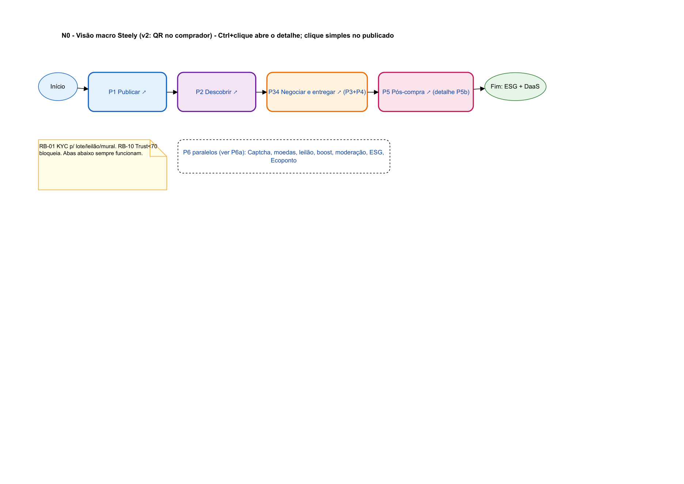
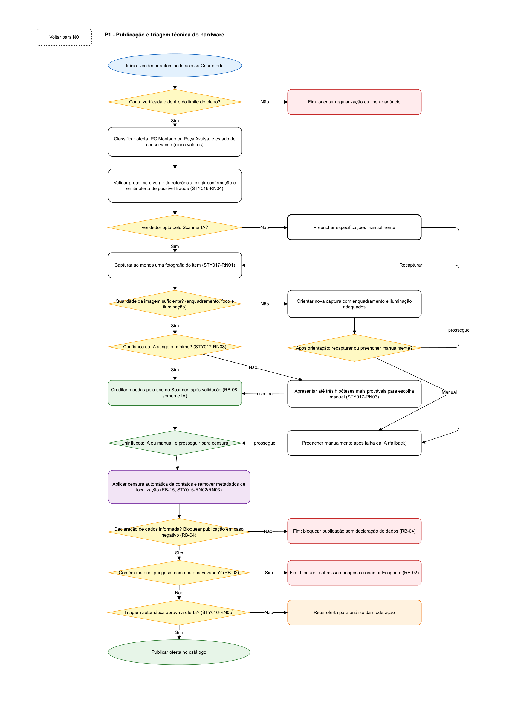
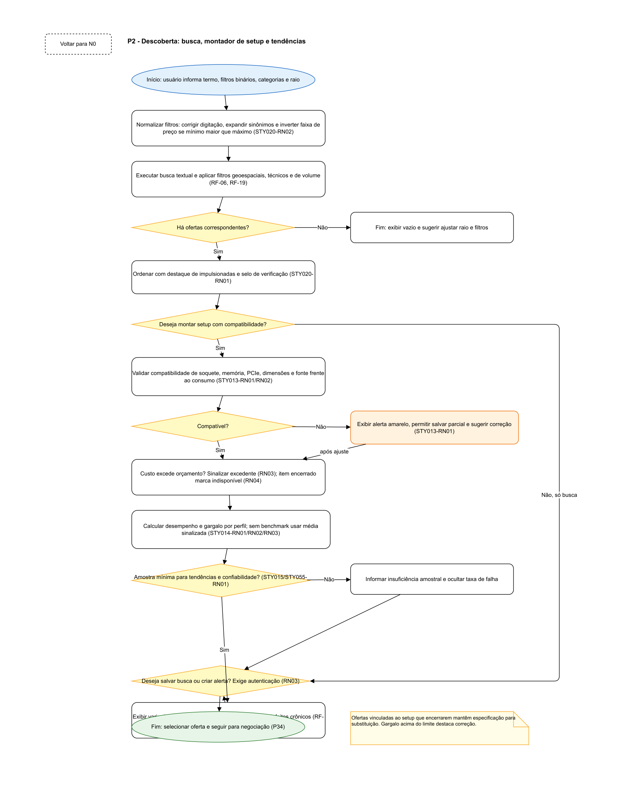
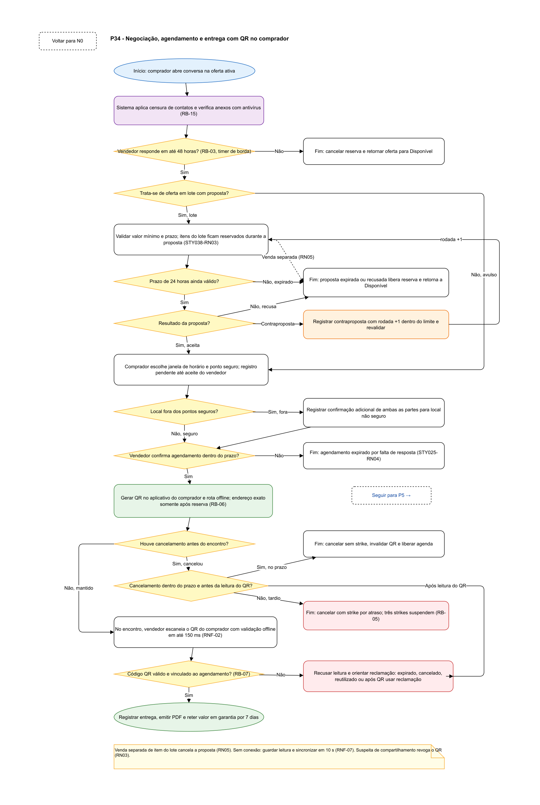
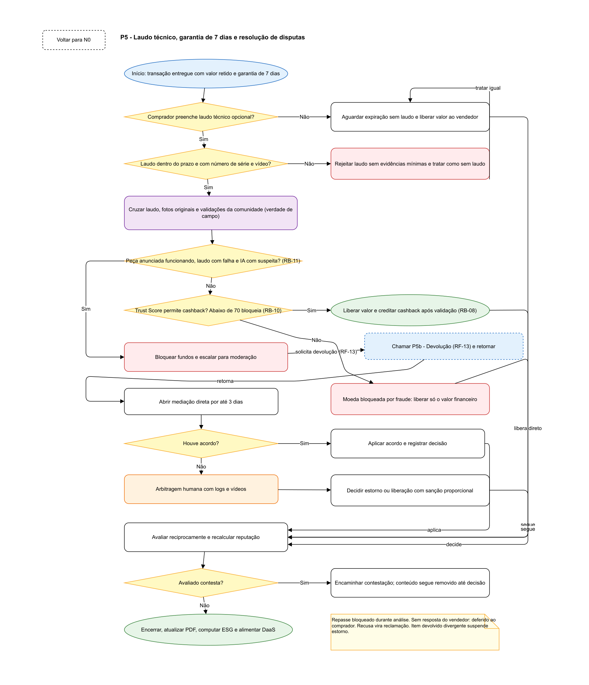
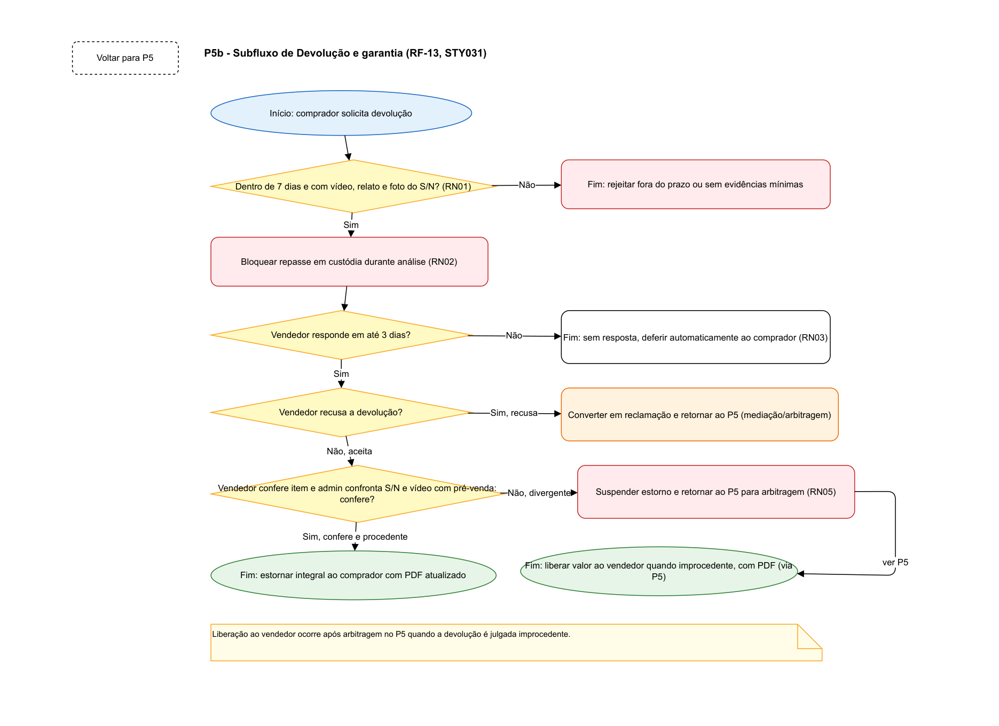
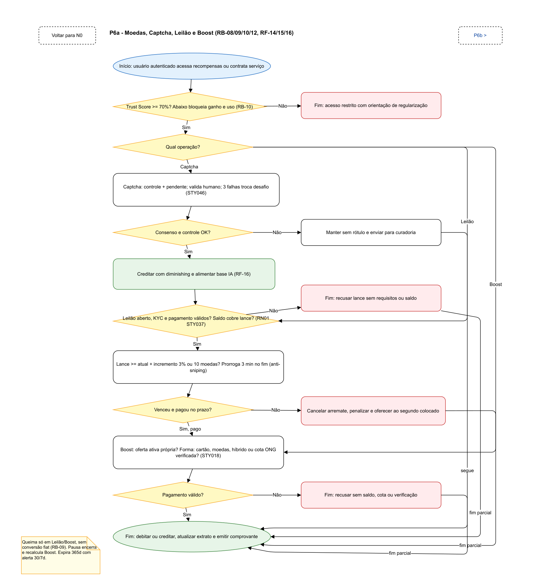
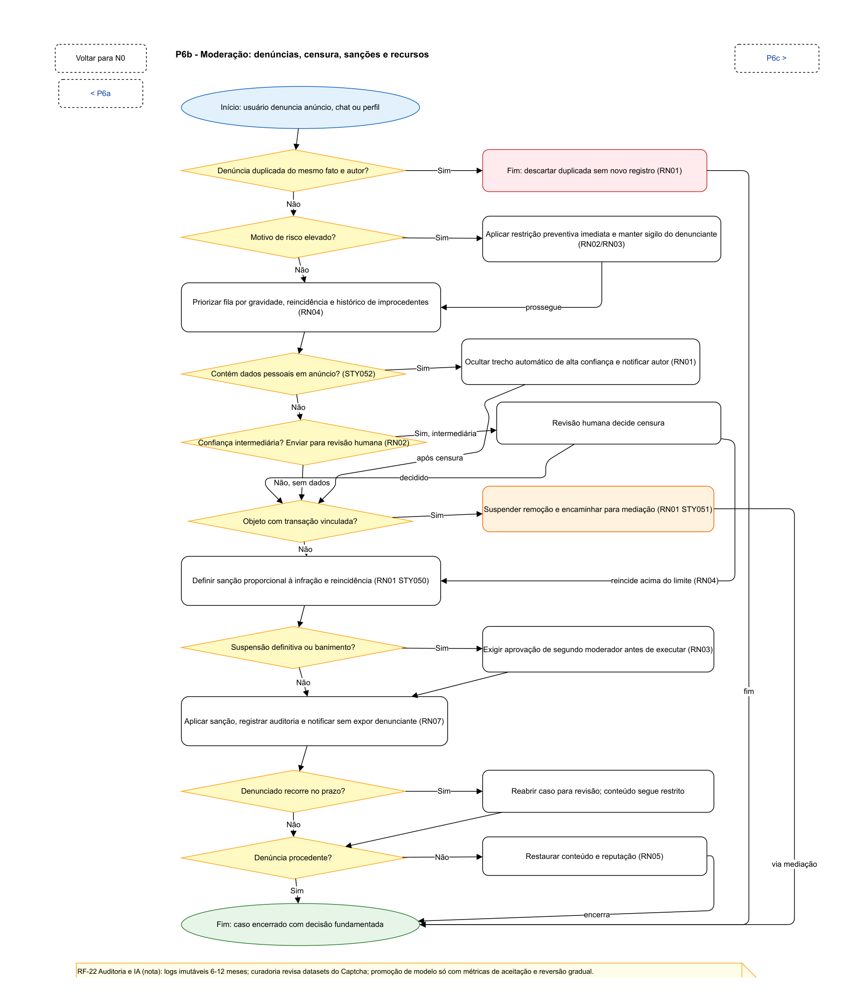
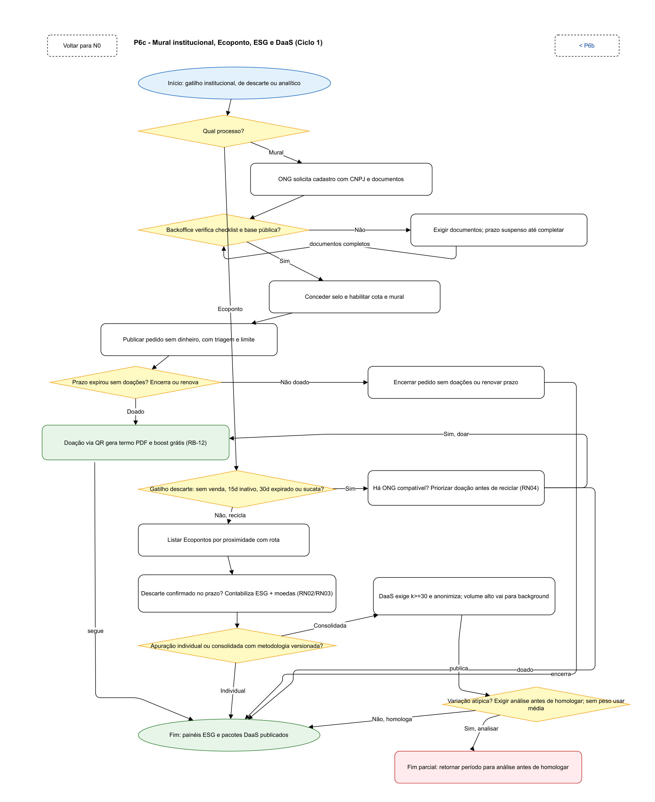

# Diagrama de Atividades e Fluxos de Processo (BPMN) — Projeto Steely

> **Arquivo Original em PDF:** [`originais/Diagrama_de_Fluxo_BPMN.pdf`](originais/Diagrama_de_Fluxo_BPMN.pdf)  
> **Escopo:** Mapeamento completo dos processos de negócio ponta a ponta (`N0`, `P1`, `P2`, `P34`, `P5`, `P5b`, `P6a`, `P6b`, `P6c`).

---

## N0 — Visão Macro do Ecossistema Steely



<details>
<summary>📄 Ver transcrição textual das raias, decisões e regras de negócio deste fluxo (Página 1)</summary>

```text
N0 - Visão macro Steely (v2: QR no comprador) - Ctrl+clique abre o detalhe; clique simples no publicado
Início
P1 Publicar ↗
P2 Descobrir ↗
P34 Negociar e entregar ↗ (P3+P4)
P5 Pós-compra ↗ (detalhe P5b)
Fim: ESG + DaaS
P6 paralelos (ver P6a): Captcha, moedas, leilão, boost, moderação, ESG,
Ecoponto
RB-01 KYC p/ lote/leilão/mural. RB-10 Trust<70
bloqueia. Abas abaixo sempre funcionam.
```
</details>

---

## P1 — Publicação e Triagem Técnica do Hardware (Scanner IA + Censura + Data Safe)



<details>
<summary>📄 Ver transcrição textual das raias, decisões e regras de negócio deste fluxo (Página 2)</summary>

```text
Voltar para N0
P1 - Publicação e triagem técnica do hardware
Início: vendedor autenticado acessa Criar oferta
Conta verificada e dentro do limite do plano?
Fim: orientar regularização ou liberar anúncio
Classificar oferta: PC Montado ou Peça Avulsa, e estado de
conservação (cinco valores)
Validar preço: se divergir da referência, exigir confirmação e
emitir alerta de possível fraude (STY016-RN04)
Vendedor opta pelo Scanner IA?
Capturar ao menos uma fotografia do item (STY017-RN01)
Preencher especificações manualmente
Qualidade da imagem suficiente? (enquadramento, foco e
iluminação)
Orientar nova captura com enquadramento e iluminação
adequados
Após orientação: recapturar ou preencher manualmente?
Preencher manualmente após falha da IA (fallback)
Confiança da IA atinge o mínimo? (STY017-RN03)
Apresentar até três hipóteses mais prováveis para escolha
manual (STY017-RN03)
Creditar moedas pelo uso do Scanner, após validação (RB-08,
somente IA)
Unir fluxos: IA ou manual, e prosseguir para censura
Aplicar censura automática de contatos e remover metadados de
localização (RB-15, STY016-RN02/RN03)
Declaração de dados informada? Bloquear publicação em caso
negativo (RB-04)
Fim: bloquear publicação sem declaração de dados (RB-04)
Contém material perigoso, como bateria vazando? (RB-02)
Fim: bloquear submissão perigosa e orientar Ecoponto (RB-02)
Triagem automática aprova a oferta? (STY016-RN05)
Reter oferta para análise da moderação
Publicar oferta no catálogo
Sim
Sim
Sim
Sim
Não
Não
Não
Manual
Não
Sim
Sim
Não
Sim
Não
prossegue
Não
escolha
Recapturar
prossegue
```
</details>

---

## P2 — Descoberta: Busca Geográfica, Montador de Setup e Tendências



<details>
<summary>📄 Ver transcrição textual das raias, decisões e regras de negócio deste fluxo (Página 3)</summary>

```text
Voltar para N0
P2 - Descoberta: busca, montador de setup e tendências
Início: usuário informa termo, filtros binários, categorias e raio
Normalizar filtros: corrigir digitação, expandir sinônimos e inverter faixa de
preço se mínimo maior que máximo (STY020-RN02)
Executar busca textual e aplicar filtros geoespaciais, técnicos e de volume
(RF-06, RF-19)
Há ofertas correspondentes?
Fim: exibir vazio e sugerir ajustar raio e filtros
Ordenar com destaque de impulsionadas e selo de verificação (STY020-
RN01)
Deseja montar setup com compatibilidade?
Validar compatibilidade de soquete, memória, PCIe, dimensões e fonte frente
ao consumo (STY013-RN01/RN02)
Compatível?
Exibir alerta amarelo, permitir salvar parcial e sugerir correção
(STY013-RN01)
Custo excede orçamento? Sinalizar excedente (RN03); item encerrado
marca indisponível (RN04)
Calcular desempenho e gargalo por perfil; sem benchmark usar média
sinalizada (STY014-RN01/RN02/RN03)
Amostra mínima para tendências e confiabilidade? (STY015/STY055-
RN01)
Informar insuficiência amostral e ocultar taxa de falha
Exibir variação de preço, setups populares e painel de defeitos crônicos (RF-
04)
Deseja salvar busca ou criar alerta? Exige autenticação (RN03)
Fim: selecionar oferta e seguir para negociação (P34)
Ofertas vinculadas ao setup que encerrarem mantêm especificação para
substituição. Gargalo acima do limite destaca correção.
Não
Sim
Sim
Não
Sim
após ajuste
Não
Sim
Não, só busca
```
</details>

---

## P34 — Negociação, Reserva (48 h), Agendamento, Rota Offline e Entrega com QR Code no Comprador



<details>
<summary>📄 Ver transcrição textual das raias, decisões e regras de negócio deste fluxo (Página 4)</summary>

```text
Voltar para N0
P34 - Negociação, agendamento e entrega com QR no comprador
Início: comprador abre conversa na oferta ativa
Sistema aplica censura de contatos e verifica anexos com antivírus
(RB-15)
Vendedor responde em até 48 horas? (RB-03, timer de borda)
Fim: cancelar reserva e retornar oferta para Disponível
Trata-se de oferta em lote com proposta?
Validar valor mínimo e prazo; itens do lote ficam reservados durante a
proposta (STY038-RN03)
Prazo de 24 horas ainda válido?
Fim: proposta expirada ou recusada libera reserva e retorna a
Disponível
Resultado da proposta?
Registrar contraproposta com rodada +1 dentro do limite e
revalidar
Comprador escolhe janela de horário e ponto seguro; registro
pendente até aceite do vendedor
Local fora dos pontos seguros?
Registrar confirmação adicional de ambas as partes para local
não seguro
Vendedor confirma agendamento dentro do prazo?
Fim: agendamento expirado por falta de resposta (STY025-
RN04)
Gerar QR no aplicativo do comprador e rota offline; endereço exato
somente após reserva (RB-06)
Houve cancelamento antes do encontro?
Cancelamento dentro do prazo e antes da leitura do QR?
Fim: cancelar sem strike, invalidar QR e liberar agenda
Fim: cancelar com strike por atraso; três strikes suspendem (RB-
05)
No encontro, vendedor escaneia o QR do comprador com validação offline
em até 150 ms (RNF-02)
Código QR válido e vinculado ao agendamento? (RB-07)
Registrar entrega, emitir PDF e reter valor em garantia por 7 dias
Recusar leitura e orientar reclamação: expirado, cancelado,
reutilizado ou após QR usar reclamação
Seguir para P5 →
Venda separada de item do lote cancela a proposta (RN05). Sem conexão: guardar leitura e sincronizar em 10 s (RNF-07). Suspeita de compartilhamento revoga o QR
(RN03).
Não
Sim
Sim, lote
Venda separada (RN05)
Não, expirado
Sim
Sim, aceita
Não, recusa
Contraproposta
Sim, fora
Não, seguro
Sim
Não
Sim, cancelou
Não, mantido
Sim, no prazo
Não, tardio
Após leitura do QR
Sim
Não
Não, avulso
rodada +1
```
</details>

---

## P5 — Pós-Compra: Laudo Técnico, Garantia de 7 Dias (Escrow) e Resolução de Disputas



<details>
<summary>📄 Ver transcrição textual das raias, decisões e regras de negócio deste fluxo (Página 5)</summary>

```text
Voltar para N0
P5 - Laudo técnico, garantia de 7 dias e resolução de disputas
Início: transação entregue com valor retido e garantia de 7 dias
Comprador preenche laudo técnico opcional?
Aguardar expiração sem laudo e liberar valor ao vendedor
Laudo dentro do prazo e com número de série e vídeo?
Rejeitar laudo sem evidências mínimas e tratar como sem laudo
Cruzar laudo, fotos originais e validações da comunidade (verdade de
campo)
Peça anunciada funcionando, laudo com falha e IA com suspeita? (RB-11)
Trust Score permite cashback? Abaixo de 70 bloqueia (RB-10)
Liberar valor e creditar cashback após validação (RB-08)
Moeda bloqueada por fraude: liberar só o valor financeiro
Bloquear fundos e escalar para moderação
Chamar P5b - Devolução (RF-13) e retornar
solicita devolução (RF-13)
Abrir mediação direta por até 3 dias
retorna
Houve acordo?
Aplicar acordo e registrar decisão
Arbitragem humana com logs e vídeos
Decidir estorno ou liberação com sanção proporcional
Avaliar reciprocamente e recalcular reputação
Avaliado contesta?
Encaminhar contestação; conteúdo segue removido até decisão
Encerrar, atualizar PDF, computar ESG e alimentar DaaS
Repasse bloqueado durante análise. Sem resposta do vendedor: deferido ao
comprador. Recusa vira reclamação. Item devolvido divergente suspende
estorno.
Não
Sim
Não
Sim
Não
Sim
Sim
Não
Sim
Não
Sim
Não
libera direto
tratar igual
segue
segue
aplica
decide
```
</details>

---

## P5b — Subfluxo de Devolução e Garantia de 7 Dias (RF-13, STY031)



<details>
<summary>📄 Ver transcrição textual das raias, decisões e regras de negócio deste fluxo (Página 6)</summary>

```text
Voltar para P5
P5b - Subfluxo de Devolução e garantia (RF-13, STY031)
Início: comprador solicita devolução
Dentro de 7 dias e com vídeo, relato e foto do S/N? (RN01)
Fim: rejeitar fora do prazo ou sem evidências mínimas
Bloquear repasse em custódia durante análise (RN02)
Vendedor responde em até 3 dias?
Fim: sem resposta, deferir automaticamente ao comprador (RN03)
Vendedor recusa a devolução?
Converter em reclamação e retornar ao P5 (mediação/arbitragem)
Vendedor confere item e admin confronta S/N e vídeo com pré-venda:
confere?
Suspender estorno e retornar ao P5 para arbitragem (RN05)
Fim: estornar integral ao comprador com PDF atualizado
Fim: liberar valor ao vendedor quando improcedente, com PDF (via
P5)
Liberação ao vendedor ocorre após arbitragem no P5 quando a devolução é julgada improcedente.
Não
Sim
Não
Sim
Sim, recusa
Não, aceita
Não, divergente
Sim, confere e procedente
ver P5
```
</details>

---

## P6a — Processos Paralelos: Moedas Virtuais, Hardware Captcha, Leilão com Anti-Sniping e Boost



<details>
<summary>📄 Ver transcrição textual das raias, decisões e regras de negócio deste fluxo (Página 7)</summary>

```text
Voltar para N0
P6b >
P6a - Moedas, Captcha, Leilão e Boost (RB-08/09/10/12, RF-14/15/16)
Início: usuário autenticado acessa recompensas ou contrata serviço
Trust Score >= 70%? Abaixo bloqueia ganho e uso (RB-10)
Fim: acesso restrito com orientação de regularização
Qual operação?
Captcha: controle + pendente; valida humano; 3 falhas troca desafio
(STY046)
Consenso e controle OK?
Manter sem rótulo e enviar para curadoria
Creditar com diminishing e alimentar base IA (RF-16)
Leilão aberto, KYC e pagamento válidos? Saldo cobre lance? (RN01
STY037)
Fim: recusar lance sem requisitos ou saldo
Lance >= atual + incremento 3% ou 10 moedas? Prorroga 3 min no fim (anti-
sniping)
Venceu e pagou no prazo?
Cancelar arremate, penalizar e oferecer ao segundo colocado
Boost: oferta ativa própria? Forma: cartão, moedas, híbrido ou cota ONG
verificada? (STY018)
Pagamento válido?
Fim: recusar sem saldo, cota ou verificação
Fim: debitar ou creditar, atualizar extrato e emitir comprovante
Queima só em Leilão/Boost, sem
conversão fiat (RB-09). Pausa encerra
e recalcula Boost. Expira 365d com
alerta 30/7d.
Não
Sim
Captcha
Não
Sim
Não
Sim
Não
Sim, pago
Não
Sim
Leilão
Boost
segue
fim parcial
fim parcial
fim parcial
```
</details>

---

## P6b — Moderação: Denúncias, Censura de Dados Pessoais, Sanções e Dupla Aprovação



<details>
<summary>📄 Ver transcrição textual das raias, decisões e regras de negócio deste fluxo (Página 8)</summary>

```text
Voltar para N0
< P6a
P6c >
P6b - Moderação: denúncias, censura, sanções e recursos
Início: usuário denuncia anúncio, chat ou perfil
Denúncia duplicada do mesmo fato e autor?
Fim: descartar duplicada sem novo registro (RN01)
Motivo de risco elevado?
Aplicar restrição preventiva imediata e manter sigilo do denunciante
(RN02/RN03)
Priorizar fila por gravidade, reincidência e histórico de improcedentes
(RN04)
Contém dados pessoais em anúncio? (STY052)
Ocultar trecho automático de alta confiança e notificar autor (RN01)
Confiança intermediária? Enviar para revisão humana (RN02)
Revisão humana decide censura
Objeto com transação vinculada?
Suspender remoção e encaminhar para mediação (RN01 STY051)
Definir sanção proporcional à infração e reincidência (RN01 STY050)
Suspensão definitiva ou banimento?
Exigir aprovação de segundo moderador antes de executar (RN03)
Aplicar sanção, registrar auditoria e notificar sem expor denunciante (RN07)
Denunciado recorre no prazo?
Reabrir caso para revisão; conteúdo segue restrito
Denúncia procedente?
Restaurar conteúdo e reputação (RN05)
Fim: caso encerrado com decisão fundamentada
Sim
Não
Sim
prossegue
Não
Sim
Não
Sim, intermediária
Não, sem dados
após censura
decidido
Sim
Não
reincide acima do limite (RN04)
Sim
Não
Sim
Não
Sim
Não
via mediação
fim
encerra
RF-22 Auditoria e IA (nota): logs imutáveis 6-12 meses; curadoria revisa datasets do Captcha; promoção de modelo só com métricas de aceitação e reversão gradual.
```
</details>

---

## Processo — Página 9


<details>
<summary>📄 Ver transcrição textual das raias, decisões e regras de negócio deste fluxo (Página 9)</summary>

```text

```
</details>

---

## P6c — Mural Institucional (ONGs/Escolas), Ecopontos, Painel ESG e DaaS (k ≥ 30)



<details>
<summary>📄 Ver transcrição textual das raias, decisões e regras de negócio deste fluxo (Página 10)</summary>

```text
Voltar para N0
< P6b
P6c - Mural institucional, Ecoponto, ESG e DaaS (Ciclo 1)
Início: gatilho institucional, de descarte ou analítico
Qual processo?
ONG solicita cadastro com CNPJ e documentos
Backoffice verifica checklist e base pública?
Exigir documentos; prazo suspenso até completar
Conceder selo e habilitar cota e mural
Publicar pedido sem dinheiro, com triagem e limite
Prazo expirou sem doações? Encerra ou renova
Encerrar pedido sem doações ou renovar prazo
Doação via QR gera termo PDF e boost grátis (RB-12)
Não doado
documentos completos
Gatilho descarte: sem venda, 15d inativo, 30d expirado ou sucata?
Há ONG compatível? Priorizar doação antes de reciclar (RN04)
Sim, doar
Listar Ecopontos por proximidade com rota
Descarte confirmado no prazo? Contabiliza ESG + moedas (RN02/RN03)
Apuração individual ou consolidada com metodologia versionada?
DaaS exige k>=30 e anonimiza; volume alto vai para background
Variação atípica? Exigir análise antes de homologar; sem peso usar
média
Não, homologa
Sim, analisar
Fim parcial: retornar período para análise antes de homologar
doado
encerra
Fim: painéis ESG e pacotes DaaS publicados
Mural
Não
Sim
Doado
Ecoponto
Sim
Não, recicla
Consolidada
Individual
segue
publica
```
</details>

---
