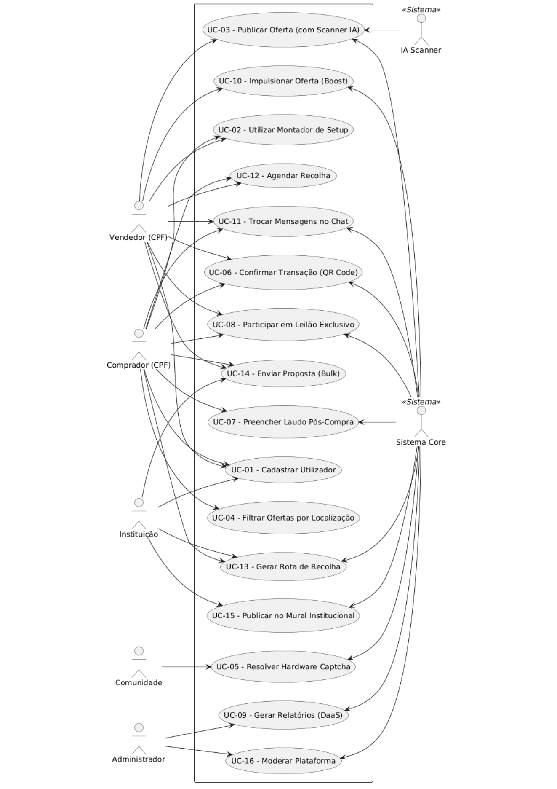

# Diagrama de Casos de Uso — Projeto Steely

> **Arquivo Original em PDF:** [`originais/Diagrama_de_Casos_de_Uso.pdf`](originais/Diagrama_de_Casos_de_Uso.pdf)  
> **Especificação Detalhada:** [`Especificacao_de_Casos_de_Uso.md`](Especificacao_de_Casos_de_Uso.md)

---

## Visualização do Diagrama

---

## Mapeamento de Atores e Casos de Uso por Domínio

| Ator | Papel no Ecossistema | Casos de Uso / User Stories Principais |
| --- | --- | --- |
| **Visitante** | Usuário ainda não autenticado | Realizar Cadastro (`STY001`), Realizar Login (`STY002`, `STY003`), Resolver Captcha (`STY004`), Recuperar Conta (`STY005`), Buscar e Filtrar Ofertas (`STY020`), Consultar Guia e Ecopontos (`STY057`, `STY058`). |
| **Usuário Comum (Comprador / Vendedor)** | Membro autenticado da comunidade | Gerir Perfil, 2FA, Senha e Exclusão em 30 dias (`STY006`–`STY012`), Montar Setup e Ver Tendências (`STY013`–`STY015`), Publicar Oferta com Scanner IA e Boost (`STY016`–`STY019`), Negociar no Chat e Propor Lote (`STY021`–`STY024`, `STY038`), Agendar Encontro, Gerar Rota Offline e Confirmar Entrega via QR Code (`STY025`–`STY029`, `STY032`), Solicitar Devolução e Abrir/Escalar Reclamação (`STY031`, `STY033`, `STY034`), Participar de Leilão (`STY037`), Gerir Carteira de Moedas e Métodos de Pagamento (`STY042`–`STY045`), Resolver Hardware Captcha (`STY046`), Realizar Denúncia (`STY049`) e Consultar Métricas ESG (`STY054`). |
| **Técnico Parceiro** | Especialista credenciado para diagnóstico | Emitir e Validar Laudo Técnico Pós-Compra (`STY030`). |
| **Organização Verificada (ONG / Escola)** | Instituição validada via CNPJ/KYC | Solicitar Cadastro de ONG (`STY039`), Publicar Pedido de Doações no Mural Institucional com Boost Gratuito (`STY041`, `RB-12`). |
| **Moderador (Nível 1 e Nível 2)** | Equipe de governança e arbitragem | Analisar e Finalizar Denúncias (`STY050`), Remover Postagem (`STY051`), Encerrar Reclamação / Arbitragem com Dupla Aprovação acima de R$ 500,00 (`STY035`, `ADR-06`), Verificar ONG (`STY040`). |
| **Administrador (Back-Office)** | Gestão da plataforma, MLOps e DaaS | Criar Leilão (`STY036`), Gerir Recolhimento de Dados e Promoção Gradual de Modelos de IA (`STY047`, `STY048`, `ADR-01`), Gerar Relatórios Gerenciais DaaS com `k ≥ 30` (`STY053`, `ADR-04`), Auditar Cadeia de Logs Imutáveis (`STY056`, `ADR-05`). |
