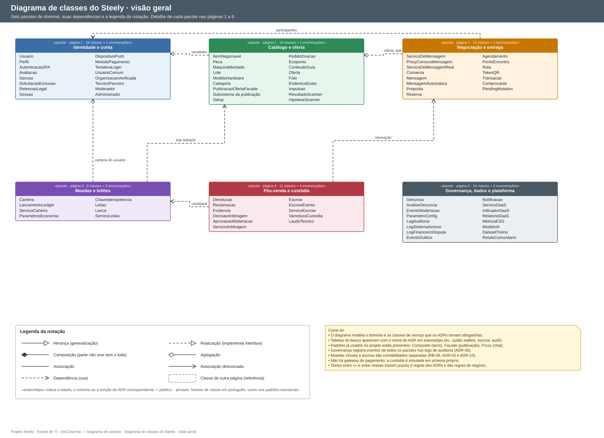
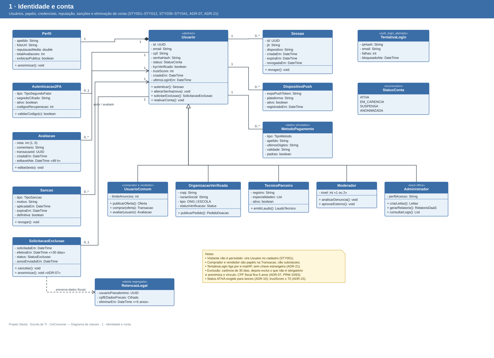
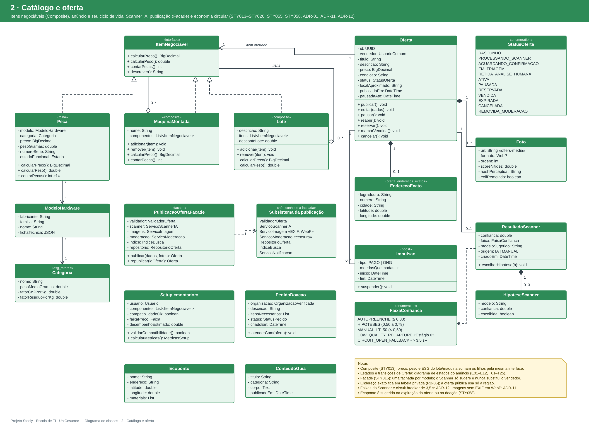
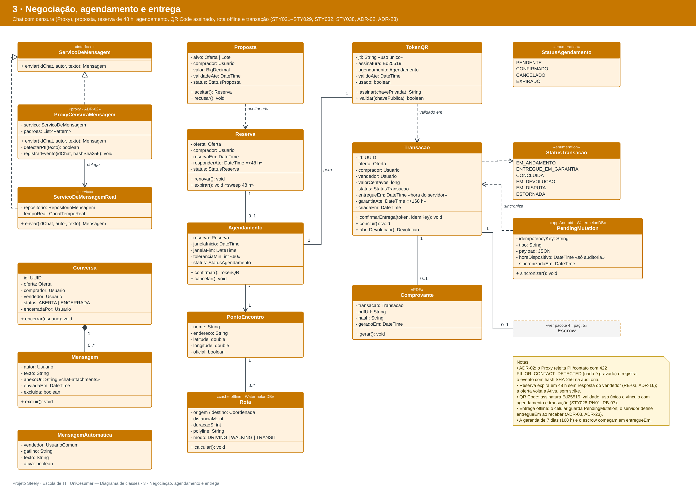
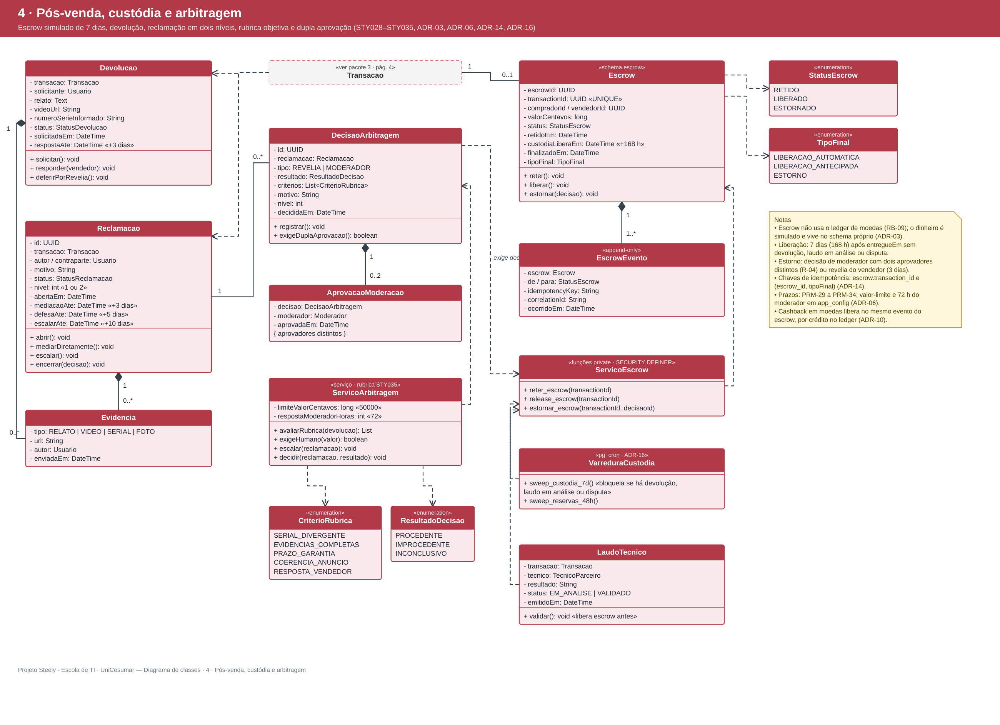
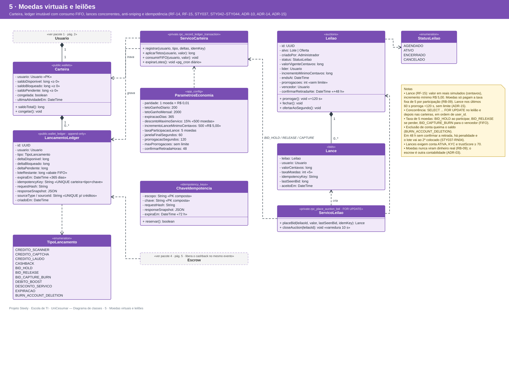
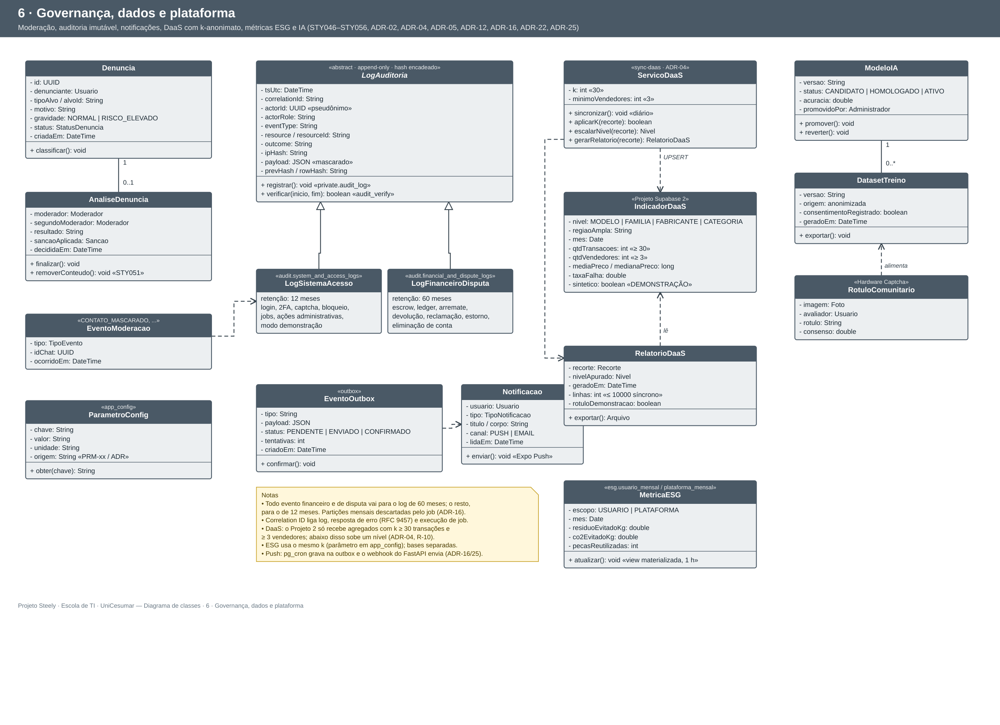
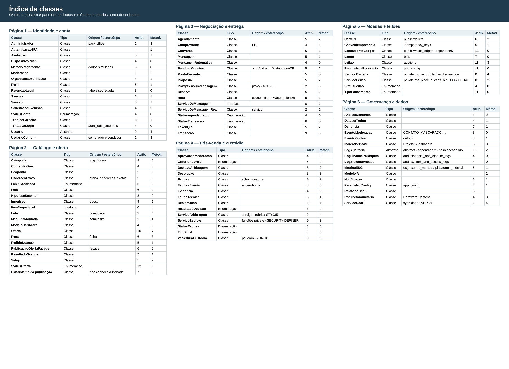

# Diagrama de Classes de Domínio e Serviços — Projeto Steely

> **Arquivo Original em PDF:** [`originais/Diagrama_de_Classes_Steely.pdf`](originais/Diagrama_de_Classes_Steely.pdf)  
> **Escopo:** **95 elementos** (classes de domínio, interfaces, serviços e enumerações) distribuídos em **6 pacotes**, alinhados aos 27 ADRs e aos Padrões de Projeto GoF.

---

## Padrões de Projeto Estruturais Aplicados (GoF)

| Padrão GoF | Pacote / Página | Classes Participantes | Problema Resolvido no Steely |
| --- | --- | --- | --- |
| **Composite** | Pacote 2 (Catálogo e Oferta) | `ItemNegociavel` (Interface), `Peca` (Folha), `MaquinaMontada` (Composite), `Lote` (Composite) | Permite tratar peças avulsas, computadores montados e lotes de hardware sob a mesma interface para cálculo recursivo de preço (`calcularPreco()`), peso (`calcularPeso()`), contagem de peças e fatores ESG (`STY013`, `RF-05`, `RF-19`). |
| **Facade** | Pacote 2 (Catálogo e Oferta) | `PublicacaoOfertaFacade` → `ValidadorOferta`, `ServicoScannerIA`, `ServicoImagem`, `ServicoModeracao`, `IndiceBusca`, `RepositorioOferta` | Desacopla o cliente do subsistema complexo de publicação (limpeza de EXIF/WebP `ADR-11`, inferência do Scanner IA `ADR-01`/`ADR-12`, censura anti-fuga `ADR-02` e indexação de busca) (`STY016`). |
| **Proxy** | Pacote 3 (Negociação e Entrega) | `ServicoDeMensagem` (Interface), `ProxyCensuraMensagem` (Proxy), `ServicoDeMensagemReal` (RealSubject) | Intercepta todo envio de mensagem no chat para detectar PII e contatos externos (`ADR-02`, `RB-15`), rejeitando com `422 PII_OR_CONTACT_DETECTED` e gravando apenas o hash `SHA-256` na auditoria antes de chegar ao serviço real (`STY021`, `STY052`). |

---

## 1. Visão Geral — 6 Pacotes de Domínio e Legenda UML



<details>
<summary>📄 Ver especificação textual completa das classes, atributos, métodos e notas desta página (Página 1)</summary>

```text
Diagrama de classes do Steely · visão geral
Seis pacotes de domínio, suas dependências e a legenda da notação. Detalhe de cada pacote nas páginas 1 a 6.
vendedor
oferta, lote
participantes
carteira do usuário
transação
cashback
lote leiloado
Legenda da notação
Herança (generalização)
Realização (implementa interface)
Composição (parte não vive sem o todo)
Agregação
Associação
Associação direcionada
Dependência (usa)
Classe de outra página (referência)
«estereótipo» indica a tabela, o schema ou a função do ADR correspondente. + público, - privado. Nomes de classe em português, como nos padrões estruturais.
«pacote · página 1 · 16 classes + 1 enumerações»
Identidade e conta
Usuario
DispositivoPush
Perfil
MetodoPagamento
Autenticacao2FA
TentativaLogin
Avaliacao
UsuarioComum
Sancao
OrganizacaoVerificada
SolicitacaoExclusao
TecnicoParceiro
RetencaoLegal
Moderador
Sessao
Administrador
«pacote · página 2 · 18 classes + 2 enumerações»
Catálogo e oferta
ItemNegociavel
PedidoDoacao
Peca
Ecoponto
MaquinaMontada
ConteudoGuia
Lote
Oferta
ModeloHardware
Foto
Categoria
EnderecoExato
PublicacaoOfertaFacade
Impulsao
Subsistema da publicação
ResultadoScanner
Setup
HipoteseScanner
«pacote · página 3 · 15 classes + 2 enumerações»
Negociação e entrega
ServicoDeMensagem
Agendamento
ProxyCensuraMensagem
PontoEncontro
ServicoDeMensagemReal
Rota
Conversa
TokenQR
Mensagem
Transacao
MensagemAutomatica
Comprovante
Proposta
PendingMutation
Reserva
«pacote · página 5 · 8 classes + 2 enumerações»
Moedas e leilões
Carteira
ChaveIdempotencia
LancamentoLedger
Leilao
ServicoCarteira
Lance
ParametrosEconomia
ServicoLeilao
«pacote · página 4 · 11 classes + 4 enumerações»
Pós-venda e custódia
Devolucao
Escrow
Reclamacao
EscrowEvento
Evidencia
ServicoEscrow
DecisaoArbitragem
VarreduraCustodia
AprovacaoModeracao
LaudoTecnico
ServicoArbitragem
«pacote · página 6 · 16 classes + 0 enumerações»
Governança, dados e plataforma
Denuncia
Notificacao
AnaliseDenuncia
ServicoDaaS
EventoModeracao
IndicadorDaaS
ParametroConfig
RelatorioDaaS
LogAuditoria
MetricaESG
LogSistemaAcesso
ModeloIA
LogFinanceiroDisputa
DatasetTreino
EventoOutbox
RotuloComunitario
Como ler
• O diagrama modela o domínio e as classes de serviço que os ADRs tornam obrigatórias.
• Tabelas do banco aparecem com o nome do ADR em estereótipo (ex.: public.wallets, escrow, audit).
• Padrões já usados no projeto estão presentes: Composite (itens), Facade (publicação), Proxy (chat).
• Governança registra eventos de todos os pacotes nos logs de auditoria (ADR-05).
• Moedas virtuais e escrow são contabilidades separadas (RB-09, ADR-03 e ADR-10).
• Não há gateway de pagamento: a custódia é simulada em schema próprio.
• Textos entre «» e entre chaves trazem prazos e regras dos ADRs e das regras de negócio.
Projeto Steely · Escola de TI · UniCesumar — Diagrama de classes · Diagrama de classes do Steely · visão geral
```
</details>

---

## 2. Pacote 1 — Identidade e Conta (16 classes + 1 enumeração)



<details>
<summary>📄 Ver especificação textual completa das classes, atributos, métodos e notas desta página (Página 2)</summary>

```text
1 · Identidade e conta
Usuários, papéis, credenciais, reputação, sanções e eliminação de conta (STY001–STY012, STY039–STY041, ADR-07, ADR-21)
1
1
1
0..1
0..*
1
autor / avaliado
0..*
1
1
0..1
preserva dados fiscais
1
0..*
1
0..*
1
0..*
«abstract»
Usuario
- id: UUID
- email: String
- cpf: String
- senhaHash: String
- status: StatusConta
- kycVerificado: boolean
- trustScore: int
- criadoEm: DateTime
- ultimoLoginEm: DateTime
+ autenticar(): Sessao
+ alterarSenha(nova): void
+ solicitarExclusao(): SolicitacaoExclusao
+ reativarConta(): void
Perfil
- apelido: String
- fotoUrl: String
- reputacaoMedia: double
- totalAvaliacoes: int
- exibicaoPublica: boolean
+ anonimizar(): void
Autenticacao2FA
- tipo: TipoSegundoFator
- segredoCifrado: String
- ativo: boolean
- codigosRecuperacao: int
+ validarCodigo(c): boolean
Avaliacao
- nota: int (1..5)
- comentario: String
- transacaoId: UUID
- criadaEm: DateTime
- editavelAte: DateTime «48 h»
+ editar(texto): void
Sancao
- tipo: TipoSancao
- motivo: String
- aplicadaEm: DateTime
- expiraEm: DateTime
- definitiva: boolean
+ revogar(): void
SolicitacaoExclusao
- solicitadaEm: DateTime
- efetivaEm: DateTime «+30 dias»
- status: StatusExclusao
- avisoEnviadoEm: DateTime
+ cancelar(): void
+ anonimizar(): void «ADR-07»
«tabela segregada»
RetencaoLegal
- usuarioPseudonimo: UUID
- cpfEDadosFiscais: Cifrado
- eliminarEm: DateTime «+5 anos»
Sessao
- id: UUID
- jti: String
- dispositivo: String
- criadaEm: DateTime
- expiraEm: DateTime
- revogadaEm: DateTime
+ revogar(): void
DispositivoPush
- expoPushToken: String
- plataforma: String
- ativo: boolean
- registradoEm: DateTime
«dados simulados»
MetodoPagamento
- tipo: TipoMetodo
- apelido: String
- ultimosDigitos: String
- validade: String
- padrao: boolean
«auth_login_attempts»
TentativaLogin
- ipHash: String
- email: String
- falhas: int
- bloqueadoAte: DateTime
«enumeration»
StatusConta
ATIVA
EM_CARENCIA
SUSPENSA
ANONIMIZADA
«comprador e vendedor»
UsuarioComum
- limiteAnuncios: int
+ publicarOferta(): Oferta
+ comprar(oferta): Transacao
+ avaliar(usuario): Avaliacao
OrganizacaoVerificada
- cnpj: String
- razaoSocial: String
- tipo: ONG | ESCOLA
- statusVerificacao: Status
+ publicarPedido(): PedidoDoacao
TecnicoParceiro
- registro: String
- especialidades: List
- ativo: boolean
+ emitirLaudo(): LaudoTecnico
Moderador
- nivel: int «1 ou 2»
+ analisarDenuncia(): void
+ aprovarEstorno(): void
«back-office»
Administrador
- perfilAcesso: String
+ criarLeilao(): Leilao
+ gerarRelatorio(): RelatorioDaaS
+ consultarLogs(): List
Notas
• Visitante não é persistido: vira Usuario no cadastro (STY001).
• Comprador e vendedor são papéis na Transacao, não subclasses.
• TentativaLogin liga por e-mail/IP, sem chave estrangeira (ADR-21).
• Exclusão: carência de 30 dias, depois exclui o que não é obrigatório
e anonimiza o vínculo; CPF fiscal fica 5 anos (ADR-07, PRM-10/63).
• Status ATIVA exigido para lances (ADR-10); trustScore ≥ 70 (ADR-15).
Projeto Steely · Escola de TI · UniCesumar — Diagrama de classes · 1 · Identidade e conta
```
</details>

---

## 3. Pacote 2 — Catálogo e Oferta — Padrões Composite e Facade (18 classes + 2 enumerações)



<details>
<summary>📄 Ver especificação textual completa das classes, atributos, métodos e notas desta página (Página 3)</summary>

```text
2 · Catálogo e oferta
Itens negociáveis (Composite), anúncio e seu ciclo de vida, Scanner IA, publicação (Facade) e economia circular (STY013–STY020, STY055, STY058, ADR-01, ADR-11, ADR-12)
0..*
0..*
itens
1
1
item ofertado
*
1
*
1
1
1..*
1
0..1
1
0..*
1
0..1
1
0..3
«interface»
ItemNegociavel
+ calcularPreco(): BigDecimal
+ calcularPeso(): double
+ contarPecas(): int
+ descrever(): String
«folha»
Peca
- modelo: ModeloHardware
- categoria: Categoria
- preco: BigDecimal
- pesoGramas: double
- numeroSerie: String
- estadoFuncional: Estado
+ calcularPreco(): BigDecimal
+ calcularPeso(): double
+ contarPecas(): int «1»
«composite»
MaquinaMontada
- nome: String
- componentes: List<ItemNegociavel>
+ adicionar(item): void
+ remover(item): void
+ calcularPreco(): BigDecimal
+ contarPecas(): int
«composite»
Lote
- descricao: String
- itens: List<ItemNegociavel>
- descontoLote: double
+ adicionar(item): void
+ remover(item): void
+ calcularPreco(): BigDecimal
+ calcularPeso(): double
ModeloHardware
- fabricante: String
- familia: String
- nome: String
- fichaTecnica: JSON
«esg_fatores»
Categoria
- nome: String
- pesoMedioGramas: double
- fatorCo2PorKg: double
- fatorResiduoPorKg: double
«facade»
PublicacaoOfertaFacade
- validador: ValidadorOferta
- scanner: ServicoScannerIA
- imagens: ServicoImagem
- moderacao: ServicoModeracao
- indice: IndiceBusca
- repositorio: RepositorioOferta
+ publicar(dados, fotos): Oferta
+ republicar(idOferta): Oferta
«não conhece a fachada»
Subsistema da publicação
ValidadorOferta
ServicoScannerIA
ServicoImagem «EXIF, WebP»
ServicoModeracao «censura»
RepositorioOferta
IndiceBusca
ServicoNotificacao
Setup «montador»
- usuario: Usuario
- componentes: List<ItemNegociavel>
- compatibilidadeOk: boolean
- faixaPreco: Faixa
- desempenhoEstimado: double
+ validarCompatibilidade(): boolean
+ calcularMetricas(): MetricasSetup
PedidoDoacao
- organizacao: OrganizacaoVerificada
- descricao: String
- itensNecessarios: List
- status: StatusPedido
- criadoEm: DateTime
+ atenderCom(oferta): void
Ecoponto
- nome: String
- endereco: String
- latitude: double
- longitude: double
- materiais: List
ConteudoGuia
- titulo: String
- categoria: String
- corpo: Text
- publicadoEm: DateTime
Oferta
- id: UUID
- vendedor: UsuarioComum
- titulo: String
- descricao: String
- preco: BigDecimal
- condicao: String
- status: StatusOferta
- localAproximado: String
- publicadaEm: DateTime
- pausadaAte: DateTime
+ publicar(): void
+ editar(dados): void
+ pausar(): void
+ reabrir(): void
+ reservar(): void
+ marcarVendida(): void
+ cancelar(): void
«enumeration»
StatusOferta
RASCUNHO
PROCESSANDO_SCANNER
AGUARDANDO_CONFIRMACAO
EM_TRIAGEM
RETIDA_ANALISE_HUMANA
ATIVA
PAUSADA
RESERVADA
VENDIDA
EXPIRADA
CANCELADA
REMOVIDA_MODERACAO
Foto
- url: String «offers-media»
- formato: WebP
- ordem: int
- scoreNitidez: double
- hashPerceptual: String
- exifRemovido: boolean
«oferta_enderecos_exatos»
EnderecoExato
- logradouro: String
- numero: String
- cidade: String
- latitude: double
- longitude: double
«boost»
Impulsao
- tipo: PAGO | ONG
- moedasQueimadas: int
- inicio: DateTime
- fim: DateTime
+ suspender(): void
ResultadoScanner
- confianca: double
- faixa: FaixaConfianca
- modeloSugerido: String
- origem: IA | MANUAL
- criadoEm: DateTime
+ escolherHipotese(h): void
HipoteseScanner
- modelo: String
- confianca: double
- escolhida: boolean
«enumeration»
FaixaConfianca
AUTOPREENCHE (≥ 0,80)
HIPOTESES (0,50 a 0,79)
MANUAL_LT_50 (< 0,50)
LOW_QUALITY_RECAPTURE «Estágio 0»
CIRCUIT_OPEN_FALLBACK «> 3,5 s»
Notas
• Composite (STY013): preço, peso e ESG do lote/máquina somam os filhos pela mesma interface.
• Estados e transições de Oferta: diagrama de estados do anúncio (E01–E12, T01–T25).
• Facade (STY016): uma fachada por módulo; o Scanner só sugere e nunca substitui o vendedor.
• Endereço exato fica em tabela privada (RB-06); a oferta pública usa só a região.
• Faixas do Scanner e circuit breaker de 3,5 s: ADR-12. Imagens sem EXIF em WebP: ADR-11.
• Ecoponto é sugerido na expiração da oferta ou na doação (STY058).
Projeto Steely · Escola de TI · UniCesumar — Diagrama de classes · 2 · Catálogo e oferta
```
</details>

---

## 4. Pacote 3 — Negociação, Agendamento e Entrega — Padrão Proxy (15 classes + 2 enumerações)



<details>
<summary>📄 Ver especificação textual completa das classes, atributos, métodos e notas desta página (Página 4)</summary>

```text
3 · Negociação, agendamento e entrega
Chat com censura (Proxy), proposta, reserva de 48 h, agendamento, QR Code assinado, rota offline e transação (STY021–STY029, STY032, STY038, ADR-02, ADR-23)
delega
1
0..*
aceitar cria
1
0..1
*
1
1
0..*
1
1
gera
validado em
1
0..1
sincroniza
1
0..1
«interface»
ServicoDeMensagem
+ enviar(idChat, autor, texto): Mensagem
«proxy · ADR-02»
ProxyCensuraMensagem
- servico: ServicoDeMensagem
- padroes: List<Pattern>
+ enviar(idChat, autor, texto): Mensagem
- detectarPII(texto): boolean
- registrarEvento(idChat, hashSha256): void
«serviço»
ServicoDeMensagemReal
- repositorio: RepositorioMensagem
- tempoReal: CanalTempoReal
+ enviar(idChat, autor, texto): Mensagem
Conversa
- id: UUID
- oferta: Oferta
- comprador: Usuario
- vendedor: Usuario
- status: ABERTA | ENCERRADA
- encerradaPor: Usuario
+ encerrar(usuario): void
Mensagem
- autor: Usuario
- texto: String
- anexoUrl: String «chat-attachments»
- enviadaEm: DateTime
- excluida: boolean
+ excluir(): void
MensagemAutomatica
- vendedor: UsuarioComum
- gatilho: String
- texto: String
- ativa: boolean
Proposta
- alvo: Oferta | Lote
- comprador: Usuario
- valor: BigDecimal
- validadeAte: DateTime
- status: StatusProposta
+ aceitar(): Reserva
+ recusar(): void
Reserva
- oferta: Oferta
- comprador: Usuario
- reservaEm: DateTime
- responderAte: DateTime «+48 h»
- status: StatusReserva
+ renovar(): void
+ expirar(): void «sweep 48 h»
Agendamento
- reserva: Reserva
- janelaInicio: DateTime
- janelaFim: DateTime
- toleranciaMin: int «60»
- status: StatusAgendamento
+ confirmar(): TokenQR
+ cancelar(): void
PontoEncontro
- nome: String
- endereco: String
- latitude: double
- longitude: double
- oficial: boolean
«cache offline · WatermelonDB»
Rota
- origem / destino: Coordenada
- distanciaM: int
- duracaoS: int
- polyline: String
- modo: DRIVING | WALKING | TRANSIT
+ calcular(): void
TokenQR
- jti: String «uso único»
- assinatura: Ed25519
- agendamento: Agendamento
- validoAte: DateTime
- usado: boolean
+ assinar(chavePrivada): String
+ validar(chavePublica): boolean
Transacao
- id: UUID
- oferta: Oferta
- comprador: Usuario
- vendedor: Usuario
- valorCentavos: long
- status: StatusTransacao
- entregueEm: DateTime «hora do servidor»
- garantiaAte: DateTime «+168 h»
- criadaEm: DateTime
+ confirmarEntrega(token, idemKey): void
+ concluir(): void
+ abrirDevolucao(): Devolucao
«PDF»
Comprovante
- transacao: Transacao
- pdfUrl: String
- hash: String
- geradoEm: DateTime
+ gerar(): void
«app Android · WatermelonDB»
PendingMutation
- idempotencyKey: String
- tipo: String
- payload: JSON
- horaDispositivo: DateTime «só auditoria»
- sincronizadaEm: DateTime
+ sincronizar(): void
«enumeration»
StatusTransacao
EM_ANDAMENTO
ENTREGUE_EM_GARANTIA
CONCLUIDA
EM_DEVOLUCAO
EM_DISPUTA
ESTORNADA
«enumeration»
StatusAgendamento
PENDENTE
CONFIRMADO
CANCELADO
EXPIRADO
«ver pacote 4 · pág. 5»
Escrow
Notas
• ADR-02: o Proxy rejeita PII/contato com 422
PII_OR_CONTACT_DETECTED (nada é gravado) e registra
o evento com hash SHA-256 na auditoria.
• Reserva expira em 48 h sem resposta do vendedor (RB-03, ADR-16);
a oferta volta a Ativa, sem strike.
• QR Code: assinatura Ed25519, validade, uso único e vínculo com
agendamento e transação (STY028-RN01, RB-07).
• Entrega offline: o celular guarda PendingMutation; o servidor define
entregueEm ao receber (ADR-03, ADR-23).
• A garantia de 7 dias (168 h) e o escrow começam em entregueEm.
Projeto Steely · Escola de TI · UniCesumar — Diagrama de classes · 3 · Negociação, agendamento e entrega
```
</details>

---

## 5. Pacote 4 — Pós-Venda, Custódia e Arbitragem (11 classes + 4 enumerações)



<details>
<summary>📄 Ver especificação textual completa das classes, atributos, métodos e notas desta página (Página 5)</summary>

```text
4 · Pós-venda, custódia e arbitragem
Escrow simulado de 7 dias, devolução, reclamação em dois níveis, rubrica objetiva e dupla aprovação (STY028–STY035, ADR-03, ADR-06, ADR-14, ADR-16)
1
0..1
1
0..*
1
0..2
1
0..*
1
0..*
exige decisão
1
1..*
Devolucao
- transacao: Transacao
- solicitante: Usuario
- relato: Text
- videoUrl: String
- numeroSerieInformado: String
- status: StatusDevolucao
- solicitadaEm: DateTime
- respostaAte: DateTime «+3 dias»
+ solicitar(): void
+ responder(vendedor): void
+ deferirPorRevelia(): void
Reclamacao
- id: UUID
- transacao: Transacao
- autor / contraparte: Usuario
- motivo: String
- status: StatusReclamacao
- nivel: int «1 ou 2»
- abertaEm: DateTime
- mediacaoAte: DateTime «+3 dias»
- defesaAte: DateTime «+5 dias»
- escalarAte: DateTime «+10 dias»
+ abrir(): void
+ mediarDiretamente(): void
+ escalar(): void
+ encerrar(decisao): void
Evidencia
- tipo: RELATO | VIDEO | SERIAL | FOTO
- url: String
- autor: Usuario
- enviadaEm: DateTime
«ver pacote 3 · pág. 4»
Transacao
DecisaoArbitragem
- id: UUID
- reclamacao: Reclamacao
- tipo: REVELIA | MODERADOR
- resultado: ResultadoDecisao
- criterios: List<CriterioRubrica>
- motivo: String
- nivel: int
- decididaEm: DateTime
+ registrar(): void
+ exigeDuplaAprovacao(): boolean
AprovacaoModeracao
- decisao: DecisaoArbitragem
- moderador: Moderador
- aprovadaEm: DateTime
{ aprovadores distintos }
«serviço · rubrica STY035»
ServicoArbitragem
- limiteValorCentavos: long «50000»
- respostaModeradorHoras: int «72»
+ avaliarRubrica(devolucao): List
+ exigeHumano(valor): boolean
+ escalar(reclamacao): void
+ decidir(reclamacao, resultado): void
«enumeration»
CriterioRubrica
SERIAL_DIVERGENTE
EVIDENCIAS_COMPLETAS
PRAZO_GARANTIA
COERENCIA_ANUNCIO
RESPOSTA_VENDEDOR
«enumeration»
ResultadoDecisao
PROCEDENTE
IMPROCEDENTE
INCONCLUSIVO
«schema escrow»
Escrow
- escrowId: UUID
- transactionId: UUID «UNIQUE»
- compradorId / vendedorId: UUID
- valorCentavos: long
- status: StatusEscrow
- retidoEm: DateTime
- custodiaLiberaEm: DateTime «+168 h»
- finalizadoEm: DateTime
- tipoFinal: TipoFinal
+ reter(): void
+ liberar(): void
+ estornar(decisao): void
«append-only»
EscrowEvento
- escrow: Escrow
- de / para: StatusEscrow
- idempotencyKey: String
- correlationId: String
- ocorridoEm: DateTime
«funções private · SECURITY DEFINER»
ServicoEscrow
+ reter_escrow(transactionId)
+ release_escrow(transactionId)
+ estornar_escrow(transactionId, decisaoId)
«pg_cron · ADR-16»
VarreduraCustodia
+ sweep_custodia_7d() «bloqueia se há devolução,
laudo em análise ou disputa»
+ sweep_reservas_48h()
LaudoTecnico
- transacao: Transacao
- tecnico: TecnicoParceiro
- resultado: String
- status: EM_ANALISE | VALIDADO
- emitidoEm: DateTime
+ validar(): void «libera escrow antes»
«enumeration»
StatusEscrow
RETIDO
LIBERADO
ESTORNADO
«enumeration»
TipoFinal
LIBERACAO_AUTOMATICA
LIBERACAO_ANTECIPADA
ESTORNO
Notas
• Escrow não usa o ledger de moedas (RB-09); o dinheiro é
simulado e vive no schema próprio (ADR-03).
• Liberação: 7 dias (168 h) após entregueEm sem
devolução, laudo em análise ou disputa.
• Estorno: decisão de moderador com dois aprovadores
distintos (R-04) ou revelia do vendedor (3 dias).
• Chaves de idempotência: escrow.transaction_id e
(escrow_id, tipoFinal) (ADR-14).
• Prazos: PRM-29 a PRM-34; valor-limite e 72 h do
moderador em app_config (ADR-06).
• Cashback em moedas libera no mesmo evento do
escrow, por crédito no ledger (ADR-10).
Projeto Steely · Escola de TI · UniCesumar — Diagrama de classes · 4 · Pós-venda, custódia e arbitragem
```
</details>

---

## 6. Pacote 5 — Moedas Virtuais e Leilões (8 classes + 2 enumerações)



<details>
<summary>📄 Ver especificação textual completa das classes, atributos, métodos e notas desta página (Página 6)</summary>

```text
5 · Moedas virtuais e leilões
Carteira, ledger imutável com consumo FIFO, lances concorrentes, anti-sniping e idempotência (RF-14, RF-15, STY037, STY042–STY044, ADR-10, ADR-14, ADR-15)
1
1
1
0..*
grava
trava
1
0..*
cria
BID_HOLD / RELEASE / CAPTURE
«ver pacote 1 · pág. 2»
Usuario
«public.wallets»
Carteira
- usuario: Usuario «PK»
- saldoDisponivel: long «≥ 0»
- saldoBloqueado: long «≥ 0»
- saldoPendente: long «≥ 0»
- congelada: boolean
- ultimaAtividadeEm: DateTime
+ saldoTotal(): long
+ congelar(): void
«public.wallet_ledger · append-only»
LancamentoLedger
- id: UUID
- usuario: Usuario
- tipo: TipoLancamento
- deltaDisponivel: long
- deltaBloqueado: long
- deltaPendente: long
- loteRestante: long «abate FIFO»
- expiraEm: DateTime «365 dias»
- idempotencyKey: String «UNIQUE carteira+tipo+chave»
- requestHash: String
- responseSnapshot: JSON
- sourceType / sourceId: String «UNIQUE p/ créditos»
- criadoEm: DateTime
«enumeration»
TipoLancamento
CREDITO_SCANNER
CREDITO_CAPTCHA
CREDITO_LAUDO
CASHBACK
BID_HOLD
BID_RELEASE
BID_CAPTURE_BURN
DEBITO_BOOST
DESCONTO_SERVICO
EXPIRACAO
BURN_ACCOUNT_DELETION
«private.rpc_record_ledger_transaction»
ServicoCarteira
+ registrar(usuario, tipo, deltas, idemKey)
+ aplicarTetos(usuario, valor): long
+ consumirFIFO(usuario, valor): void
+ expirarLotes(): void «pg_cron diário»
«app_config»
ParametrosEconomia
- paridade: 1 moeda = R$ 0,01
- tetoGanhoDiario: 200
- tetoGanhoMensal: 2000
- expiracaoDias: 365
- descontoMaximoServico: 15% «500 moedas»
- incrementoLanceMinimoCentavos: 500 «R$ 5,00»
- taxaParticipacaoLance: 5 moedas
- janelaFinalSegundos: 60
- prorrogacaoSegundos: 120
- maxProrrogacoes: sem limite
- confirmarRetiradaHoras: 48
«idempotency_keys»
ChaveIdempotencia
- escopo: String «PK composta»
- chave: String «PK composta»
- requestHash: String
- responseSnapshot: JSON
- expiraEm: DateTime «72 h»
+ reservar(): boolean
«ver pacote 4 · pág. 5 · libera o cashback no mesmo evento»
Escrow
«auctions»
Leilao
- id: UUID
- alvo: Lote | Oferta
- criadoPor: Administrador
- status: StatusLeilao
- valorVigenteCentavos: long
- lider: Usuario
- incrementoMinimoCentavos: long
- endsAt: DateTime
- prorrogacoes: int «sem limite»
- vencedor: Usuario
- confirmarRetiradaAte: DateTime «+48 h»
+ prorrogar(): void «+120 s»
+ fechar(): void
+ ofertarAoSegundo(): void
«bids»
Lance
- leilao: Leilao
- usuario: Usuario
- valorCentavos: long
- taxaMoedas: int «5»
- idempotencyKey: String
- lastSeenBid: long
- aceitoEm: DateTime
«private.rpc_place_auction_bid · FOR UPDATE»
ServicoLeilao
+ placeBid(leilaoId, valor, lastSeenBid, idemKey): Lance
+ closeAuction(leilaoId): void «varredura 10 s»
«enumeration»
StatusLeilao
AGENDADO
ATIVO
ENCERRADO
CANCELADO
Notas
• Lance (RF-15): valor em reais simulados (centavos),
incremento mínimo R$ 5,00. Moedas só pagam a taxa
fixa de 5 por participação (RB-09). Lance nos últimos
60 s prorroga +120 s, sem limite (ADR-15).
• Concorrência: SELECT ... FOR UPDATE no leilão e
depois nas carteiras, em ordem de user_id.
• Taxa de 5 moedas: BID_HOLD ao participar, BID_RELEASE
se perder, BID_CAPTURE_BURN para o vencedor (FIFO).
• Exclusão de conta queima o saldo
(BURN_ACCOUNT_DELETION).
Em 48 h sem confirmar a retirada, há penalidade e
o lote vai ao 2º colocado (STY037-RN04).
• Lances exigem conta ATIVA, KYC e trustScore ≥ 70.
• Moedas nunca viram dinheiro real (RB-09); o
escrow é outra contabilidade (ADR-03).
Projeto Steely · Escola de TI · UniCesumar — Diagrama de classes · 5 · Moedas virtuais e leilões
```
</details>

---

## 7. Pacote 6 — Governança, Dados e Plataforma (16 classes)



<details>
<summary>📄 Ver especificação textual completa das classes, atributos, métodos e notas desta página (Página 7)</summary>

```text
6 · Governança, dados e plataforma
Moderação, auditoria imutável, notificações, DaaS com k-anonimato, métricas ESG e IA (STY046–STY056, ADR-02, ADR-04, ADR-05, ADR-12, ADR-16, ADR-22, ADR-25)
1
0..1
UPSERT
lê
1
0..*
alimenta
Denuncia
- id: UUID
- denunciante: Usuario
- tipoAlvo / alvoId: String
- motivo: String
- gravidade: NORMAL | RISCO_ELEVADO
- status: StatusDenuncia
- criadaEm: DateTime
+ classificar(): void
AnaliseDenuncia
- moderador: Moderador
- segundoModerador: Moderador
- resultado: String
- sancaoAplicada: Sancao
- decididaEm: DateTime
+ finalizar(): void
+ removerConteudo(): void «STY051»
«CONTATO_MASCARADO, ...»
EventoModeracao
- tipo: TipoEvento
- idChat: UUID
- ocorridoEm: DateTime
«app_config»
ParametroConfig
- chave: String
- valor: String
- unidade: String
- origem: String «PRM-xx / ADR»
+ obter(chave): String
«abstract · append-only · hash encadeado»
LogAuditoria
- tsUtc: DateTime
- correlationId: String
- actorId: UUID «pseudônimo»
- actorRole: String
- eventType: String
- resource / resourceId: String
- outcome: String
- ipHash: String
- payload: JSON «mascarado»
- prevHash / rowHash: String
+ registrar(): void «private.audit_log»
+ verificar(inicio, fim): boolean «audit_verify»
«audit.system_and_access_logs»
LogSistemaAcesso
retenção: 12 meses
login, 2FA, captcha, bloqueio,
jobs, ações administrativas,
modo demonstração
«audit.financial_and_dispute_logs»
LogFinanceiroDisputa
retenção: 60 meses
escrow, ledger, arremate,
devolução, reclamação, estorno,
eliminação de conta
«outbox»
EventoOutbox
- tipo: String
- payload: JSON
- status: PENDENTE | ENVIADO | CONFIRMADO
- tentativas: int
- criadoEm: DateTime
+ confirmar(): void
Notificacao
- usuario: Usuario
- tipo: TipoNotificacao
- titulo / corpo: String
- canal: PUSH | EMAIL
- lidaEm: DateTime
+ enviar(): void «Expo Push»
«sync-daas · ADR-04»
ServicoDaaS
- k: int «30»
- minimoVendedores: int «3»
+ sincronizar(): void «diário»
+ aplicarK(recorte): boolean
+ escalarNivel(recorte): Nivel
+ gerarRelatorio(recorte): RelatorioDaaS
«Projeto Supabase 2»
IndicadorDaaS
- nivel: MODELO | FAMILIA | FABRICANTE | CATEGORIA
- regiaoAmpla: String
- mes: Date
- qtdTransacoes: int «≥ 30»
- qtdVendedores: int «≥ 3»
- mediaPreco / medianaPreco: long
- taxaFalha: double
- sintetico: boolean «DEMONSTRAÇÃO»
RelatorioDaaS
- recorte: Recorte
- nivelApurado: Nivel
- geradoEm: DateTime
- linhas: int «≤ 10000 síncrono»
- rotuloDemonstracao: boolean
+ exportar(): Arquivo
«esg.usuario_mensal / plataforma_mensal»
MetricaESG
- escopo: USUARIO | PLATAFORMA
- mes: Date
- residuoEvitadoKg: double
- co2EvitadoKg: double
- pecasReutilizadas: int
+ atualizar(): void «view materializada, 1 h»
ModeloIA
- versao: String
- status: CANDIDATO | HOMOLOGADO | ATIVO
- acuracia: double
- promovidoPor: Administrador
+ promover(): void
+ reverter(): void
DatasetTreino
- versao: String
- origem: anonimizada
- consentimentoRegistrado: boolean
- geradoEm: DateTime
+ exportar(): void
«Hardware Captcha»
RotuloComunitario
- imagem: Foto
- avaliador: Usuario
- rotulo: String
- consenso: double
Notas
• Todo evento financeiro e de disputa vai para o log de 60 meses; o resto,
para o de 12 meses. Partições mensais descartadas pelo job (ADR-16).
• Correlation ID liga log, resposta de erro (RFC 9457) e execução de job.
• DaaS: o Projeto 2 só recebe agregados com k ≥ 30 transações e
≥ 3 vendedores; abaixo disso sobe um nível (ADR-04, R-10).
• ESG usa o mesmo k (parâmetro em app_config); bases separadas.
• Push: pg_cron grava na outbox e o webhook do FastAPI envia (ADR-16/25).
Projeto Steely · Escola de TI · UniCesumar — Diagrama de classes · 6 · Governança, dados e plataforma
```
</details>

---

## 8. Índice Completo dos 95 Elementos (Classes, Interfaces e Enumerações)



<details>
<summary>📄 Ver especificação textual completa das classes, atributos, métodos e notas desta página (Página 8)</summary>

```text
Índice de classes
Página 1 — Identidade e conta
Classe
Tipo
Origem / estereótipo
Atrib.
Métod.
Administrador
Classe
back-office
1
3
Autenticacao2FA
Classe
4
1
Avaliacao
Classe
5
1
DispositivoPush
Classe
4
0
MetodoPagamento
Classe
dados simulados
5
0
Moderador
Classe
1
2
OrganizacaoVerificada
Classe
4
1
Perfil
Classe
5
1
RetencaoLegal
Classe
tabela segregada
3
0
Sancao
Classe
5
1
Sessao
Classe
6
1
SolicitacaoExclusao
Classe
4
2
StatusConta
Enumeração
4
0
TecnicoParceiro
Classe
3
1
TentativaLogin
Classe
auth_login_attempts
4
0
Usuario
Abstrata
9
4
UsuarioComum
Classe
comprador e vendedor
1
3
Página 2 — Catálogo e oferta
Classe
Tipo
Origem / estereótipo
Atrib.
Métod.
Categoria
Classe
esg_fatores
4
0
ConteudoGuia
Classe
4
0
Ecoponto
Classe
5
0
EnderecoExato
Classe
oferta_enderecos_exatos
5
0
FaixaConfianca
Enumeração
5
0
Foto
Classe
6
0
HipoteseScanner
Classe
3
0
Impulsao
Classe
boost
4
1
ItemNegociavel
Interface
0
4
Lote
Classe
composite
3
4
MaquinaMontada
Classe
composite
2
4
ModeloHardware
Classe
4
0
Oferta
Classe
10
7
Peca
Classe
folha
6
3
PedidoDoacao
Classe
5
1
PublicacaoOfertaFacade
Classe
facade
6
2
ResultadoScanner
Classe
5
1
Setup
Classe
5
2
StatusOferta
Enumeração
12
0
Subsistema da publicação
Classe
não conhece a fachada
7
0
Página 3 — Negociação e entrega
Classe
Tipo
Origem / estereótipo
Atrib.
Métod.
Agendamento
Classe
5
2
Comprovante
Classe
PDF
4
1
Conversa
Classe
6
1
Mensagem
Classe
5
1
MensagemAutomatica
Classe
4
0
PendingMutation
Classe
app Android · WatermelonDB
5
1
PontoEncontro
Classe
5
0
Proposta
Classe
5
2
ProxyCensuraMensagem
Classe
proxy · ADR-02
2
3
Reserva
Classe
5
2
Rota
Classe
cache offline · WatermelonDB
5
1
ServicoDeMensagem
Interface
0
1
ServicoDeMensagemReal
Classe
serviço
2
1
StatusAgendamento
Enumeração
4
0
StatusTransacao
Enumeração
6
0
TokenQR
Classe
5
2
Transacao
Classe
9
3
Página 4 — Pós-venda e custódia
Classe
Tipo
Origem / estereótipo
Atrib.
Métod.
AprovacaoModeracao
Classe
4
0
CriterioRubrica
Enumeração
5
0
DecisaoArbitragem
Classe
8
2
Devolucao
Classe
8
3
Escrow
Classe
schema escrow
9
3
EscrowEvento
Classe
append-only
5
0
Evidencia
Classe
4
0
LaudoTecnico
Classe
5
1
Reclamacao
Classe
10
4
ResultadoDecisao
Enumeração
3
0
ServicoArbitragem
Classe
serviço · rubrica STY035
2
4
ServicoEscrow
Classe
funções private · SECURITY DEFINER
0
3
StatusEscrow
Enumeração
3
0
TipoFinal
Enumeração
3
0
VarreduraCustodia
Classe
pg_cron · ADR-16
0
3
Página 5 — Moedas e leilões
Classe
Tipo
Origem / estereótipo
Atrib.
Métod.
Carteira
Classe
public.wallets
6
2
ChaveIdempotencia
Classe
idempotency_keys
5
1
LancamentoLedger
Classe
public.wallet_ledger · append-only
13
0
Lance
Classe
bids
7
0
Leilao
Classe
auctions
11
3
ParametrosEconomia
Classe
app_config
11
0
ServicoCarteira
Classe
private.rpc_record_ledger_transaction
0
4
ServicoLeilao
Classe
private.rpc_place_auction_bid · FOR UPDATE
0
2
StatusLeilao
Enumeração
4
0
TipoLancamento
Enumeração
11
0
Página 6 — Governança e dados
Classe
Tipo
Origem / estereótipo
Atrib.
Métod.
AnaliseDenuncia
Classe
5
2
DatasetTreino
Classe
4
1
Denuncia
Classe
7
1
EventoModeracao
Classe
CONTATO_MASCARADO, ...
3
0
EventoOutbox
Classe
outbox
5
1
IndicadorDaaS
Classe
Projeto Supabase 2
8
0
LogAuditoria
Abstrata
abstract · append-only · hash encadeado
10
2
LogFinanceiroDisputa
Classe
audit.financial_and_dispute_logs
4
0
LogSistemaAcesso
Classe
audit.system_and_access_logs
4
0
MetricaESG
Classe
esg.usuario_mensal / plataforma_mensal
5
1
ModeloIA
Classe
4
2
Notificacao
Classe
5
1
ParametroConfig
Classe
app_config
4
1
RelatorioDaaS
Classe
5
1
RotuloComunitario
Classe
Hardware Captcha
4
0
ServicoDaaS
Classe
sync-daas · ADR-04
2
4
95 elementos em 6 pacotes · atributos e métodos contados como desenhados
```
</details>

---
