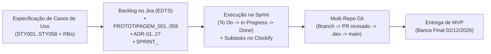

# Processo de Desenvolvimento de Software (SDLC) — Equipe Steely

> **Projeto no Jira:** `Escola de TI - Steely` (Chave: `EDTS` · Scrum · **8 Épicos (`EDTS-321..328`)** · **16 Sprints (`Sprint 1` a `Sprint 16`)**)
> **Papéis da Equipe (Turma B — Equipe 6):** **Thiago Lopes** (Product Owner / `Reporter` & Backend), **Augusto Palma** (Scrum Master & Governança/Dados), **Fabrício Notoya** (Arquitetura, Banco de Dados, Scanner IA & Backend), **Pietro Pasqual** e **Rafael Tudela** (Frontend Web & Mobile Android)
> **Ferramentas de Gestão e Engenharia:** Jira (`EDTS`) + Clockify (Meta 1.000h) + Figma + GitHub

---

## 1. Visão Geral do Processo (Scrum Adaptado + Backlog Orientado a Protótipos e ADRs)

A equipe **Steely** utiliza **Scrum** gerenciado no **Jira (`EDTS`)** integrado ao **Clockify** para rastreamento de horas. Em vez de manter um backlog burocrático de *User Stories* textuais desconectadas das telas, o time adotou um **Backlog Orientado a Telas/Protótipos e Decisões Arquiteturais (*Prototype & ADR-Driven Backlog*)**, onde:

1. **A especificação detalhada de fluxos e regras** vive nas **61 abas da planilha de Casos de Uso (`STY001` a `STY058`)** e nas **Regras de Negócio (`RB-01` a `RB-15`)**;
2. **As decisões técnicas de implementação** vivem nos **27 ADRs (`ADR-01` a `ADR-27`)**, concluídos na `SPRINT 12` por meio das tasks mestras de arquitetura (`EDTS-215` a `EDTS-219` — 5 ADRs por integrante — e `EDTS-313` para as 2 ADRs adicionais de IA/Anti-Fuga);
3. **As unidades de entrega de interface e produto** no backlog do Jira são mapeadas diretamente para as **59 telas funcionais do protótipo (`PROTOTIPAGEM_001` a `PROTOTIPAGEM_059`, cards `EDTS-252` a `EDTS-310`)**, além das tarefas técnicas da Sprint (`SPRINT<N>_<NNN>`).

---

## 2. Estrutura Real do Projeto no Jira (`EDTS`)

O espaço `EDTS` no Jira está configurado no modelo **Scrum Simplificado** com três colunas de fluxo no quadro (*Board*): **`To Do` → `In Progress` → `Done`**.

### 2.1 Convenção de Nomenclatura e Categorias de Cards
Para manter rastreabilidade direta entre o **Jira** e os relatórios de horas do **Clockify**, a equipe padronizou 4 tipos de registros (entre **206 Tasks** e **77 Subtasks**, totalizando **283 issues**):

| Padrão de Card no Jira (`EDTS`) | Exemplo Real no Quadro | Finalidade no Processo |
| :--- | :--- | :--- |
| **`SPRINT<N>_<NNN> - <Título>`** | `EDTS-318: SPRINT13_001 - Diagrama de Classe` `EDTS-319: SPRINT13_002 - Criação das DER` `EDTS-320: SPRINT13_003 - Trenamento de IA 2/4` | Entregas técnicas de engenharia, modelagem, treinamento de IA e implementação alocadas na Sprint ativa. |
| **`SPRINT<N> - GERENCIAL <CERIMÔNIA>` + Subtasks por integrante** | `EDTS-311: SPRINT13. - GERENCIAL PLANNING` ↳ `EDTS-314` (Augusto), `EDTS-315` (Fabrício), `EDTS-316` (Pietro), `EDTS-317` (Rafael) | Registro de cerimônias (*Planning*, *Daily*, *Retro* e *Aula Escola de TI*) com **1 Subtask por integrante** para apontamento exato de horas no Clockify. |
| **`SPRINT12_007 / 013 - Criação do ADR`** | `EDTS-215` a `EDTS-219` (5 ADRs por integrante) + `EDTS-313` (`ADR-01` e `ADR-02`) | Tasks mestras de consolidação das 27 decisões arquiteturais de pré-código concluídas na `SPRINT 12`. |
| **`PROTOTIPAGEM_<001..059> - <Tela>`** | `EDTS-252: PROTOTIPAGEM_001 - Home / Feed Principal` até `EDTS-310: PROTOTIPAGEM_059 - Notificação de Sanção` | Catálogo das **59 telas/fluxos do produto** (alinhadas às especificações `STY001`–`STY058`), servindo como backlog funcional de telas e implementação. |

---

## 3. Histórico Evolutivo das Sprints (`Sprint 1` a `Sprint 13+`)

O histórico do Jira (`EDTS`) documenta toda a trajetória da equipe ao longo dos dois semestres letivos de 2026:

| Fase / Período | Sprints no Jira (`EDTS`) | Entregas Realizadas (`Done`) |
| :--- | :--- | :--- |
| **Fase I — Fundação (1º Semestre)** *(Março a Junho/2026)* | `EDTS Sprint 1` a `EDTS Sprint 6` *(54 issues concluídas)* | Enquadramento do problema, mapas iniciais, primeiros levantamentos de requisitos, regras de negócio, casos de uso, diagramas preliminares e prova de conceito de setup (Git, Web, Mobile, Backend, QR Code e WebSockets). |
| **Fase II — Concepção Steely & Descoberta** *(Agosto a Setembro/2026)* | `Steely Sprint 7` a `Steely Sprint 9` *(66 issues concluídas)* | Pivô e criação da identidade **Steely**, reformulação do **TAP v3.0**, revisão completa de `RF`, `RNF` e `RN`, análises estratégicas (**SWOT, Pesquisa de Mercado, Duplo Diamante, Matriz GUT, Matriz RACI, Matriz CSD e Matriz de Rastreabilidade**), BPMN e início da prototipagem. |
| **Fase III — Arquitetura, Pipeline de Dataset IA & Pré-Código** *(Setembro a 02/Nov/2026)* | `SPRINT 10` a `SPRINT 12` *(70 issues concluídas)* | Expansão da prototipagem de alta fidelidade, estudos de Arquitetura de Software, **Etapa 1/4 do Scanner IA (`EDTS-204`: infraestrutura de coleta, sanitização WebP s/ EXIF + scrub PII, deduplicação SHA-256/pHash resultando em 2.119 imagens limpas, auto-anotação por VLM Schema V4 com 1.372/2.119 processadas e dashboard de revisão)** e elaboração das **27 ADRs (`ADR-01` a `ADR-27`)**. |
| **Fase IV — Consolidação, Treino dos Modelos & Sprint Final de MVP** *(02/Nov a 02/Dez/2026)* | `SPRINT 13` *(ativa: 02/11 a 15/11)* e Sprints 14 a 16 até a Banca (`02/12`) | Consolidação final do **DER (66 tabelas)** e **Diagrama de Classes (95 elementos)** (`EDTS-318`, `EDTS-319`), conclusão dos **59 protótipos (`PROTOTIPAGEM_001..059`)**, **Etapas 2/4 a 4/4 do Scanner IA** (conclusão da rotulagem V4, auditoria de bboxes, treino do detector `YOLO11s`, classificador hierárquico `L1–L4`, embeddings `ArcFace L5 + FAISS`, `PaddleOCR` e microserviço ONNX `/scan`) e implementação modular do **MVP funcional** para demonstração ao vivo na Banca Final (`02/12/2026`). |

### 3.1 Estratégia de Priorização para a Banca Final (Novembro/2026)
Considerando o calendário acadêmico (com a **Avaliação 05 em `03/11/2026`**, semana de provas bimestrais de `23/11 a 27/11` e **Banca Final — Avaliação 06 em `02/12/2026`**), a equipe adota uma priorização pragmática das 59 telas (`PROTOTIPAGEM_001` a `PROTOTIPAGEM_059`):
- **Foco no Caminho Feliz Demonstrável (Core MVP):** Priorização na Sprint das telas que compõem a demonstração ponta a ponta para a banca (Cadastro/Anúncio com **Scanner IA**, **Leilão/Compra com Escrow Simulado**, **Validação Presencial via QR Code `Ed25519`** e **Dashboard ESG / DaaS**), enquanto telas secundárias/institucionais (Termos de Uso, FAQ, configurações acessórias) permanecem documentadas e prototipadas como escopo complementar.

---

## 4. Organização de Repositórios (Multi-Repo) e Branches no Git

Para permitir que os 5 integrantes codifiquem em paralelo nas semanas finais sem bloqueios cruzados, o projeto utiliza **Multi-Repo** separado por camada técnica:

| Repositório / Frente | Escopo Técnico | Responsável Principal |
| :--- | :--- | :--- |
| **Documentação & Artefatos** | TAP, Requisitos, Regras de Negócio, Casos de Uso, Diagramas (DER, Classes, BPMN), Protótipos e os 27 ADRs | Toda a equipe |
| **Banco de Dados (`database`)** | Migrations PostgreSQL 15 / PostGIS (Supabase), triggers de auditoria, funções `SECURITY DEFINER` e jobs `pg_cron` | Fabrício & Augusto |
| **Backend & IA (`backend`)** | API RESTful Python 3.12 + FastAPI (`/api/v1`), motor de lances, escrow e worker do Scanner IA (ONNX INT8 + FAISS) | Thiago, Fabrício & Augusto |
| **Frontend Web (`frontend-web`)** | Web SPA, Painel Admin, DaaS e ESG em React + Vite + TypeScript + TanStack Query + Zustand + Zod | Pietro |
| **Mobile (`mobile`)** | App Android em React Native (Expo) + TypeScript + WatermelonDB (offline-first) + Google Maps/Routes | Rafael |

### 4.1 Estratégia de Branches (`main` + `dev` + branch por categoria/feature)
- **`main`:** código estável homologado ao final de cada entrega/Sprint.
- **`dev`:** branch de integração onde as entregas das diferentes frentes são reunidas e testadas.
- **Branches de trabalho (por categoria/membro ou feature):** cada integrante desenvolve em sua branch isolada e abre **Pull Request (PR)** para `dev`.

### 4.2 Padrão de Commits e Revisão (Code Review)
- **Conventional Commits:** uso de prefixos padronizados (`feat:`, `fix:`, `docs:`, `refactor:`, `test:`, `chore:`).
- **Pull Request Revisado:** merge na `dev` e na `main` mediante revisão de pelo menos **1 colega da equipe**.

---

## 5. Integração Contínua (CI) Progressiva e Definition of Done (DoD)

### 5.1 CI e Testes Progressivos
Conforme documentado no [`ADR-17`](../02-adrs/md/ADR-17_Estrategia_de_Testes.md), a verificação automatizada acompanha o ritmo das Sprints:
- Começa com validações enxutas nos Pull Requests (build, tipagem e linting);
- Evolui de forma direcionada aos fluxos de maior risco de negócio (regras de saldo/escrow, concorrência de lances, idempotência e validação do Scanner IA).

### 5.2 Definition of Done (DoD — Critério de Pronto)
Um card no Jira (`EDTS`) é movido da coluna `In Progress` para `Done` quando:
- [x] Cumpre os requisitos e as Regras de Negócio (`RB` / `STY-RN`) correspondentes à tela/funcionalidade;
- [x] Respeita as decisões técnicas estabelecidas na(s) **ADR(s)** vinculada(s);
- [x] Está versionado no Git (com *Conventional Commits* e PR revisado por 1 integrante, quando aplicável a código);
- [x] Possui as horas devidamente apontadas no **Clockify** na respectiva task/subtask da Sprint.
