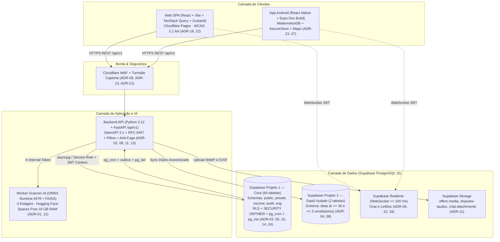

# 🛠️ Projeto Steely — Documentação de Engenharia, Arquitetura e ADRs

> **Disciplina:** Escola de TI · Engenharia de Software · UniCesumar (2026 — **Turma B · Equipe 6**)  
> **Professor:** Enderson Menezes  
> **Status dos Artefatos:** 100% Consolidados em Markdown (`.md`) + Arquivos Originais (`.pdf`, `.xlsx`, `.png`)

O **Steely** é um ecossistema digital web e mobile (Android) para comercialização segura, doação institucional e reciclagem (economia circular) de componentes de hardware de TI. Combina **Visão Computacional (Scanner IA)** para triagem técnica, **gamificação em moedas virtuais** (**Hardware Captcha** e **Laudos Técnicos**), **logística presencial offline-first** validada por **QR Code `Ed25519`** (`≤ 150 ms`), **custódia de 7 dias (*Escrow Simulado*)**, **métricas de impacto ESG** e **inteligência de mercado anonimizada (DaaS com *k-anonimato* `k ≥ 30`)**.

---

## 👥 Equipe de Desenvolvimento

| Integrante | Escopo de Responsabilidade Arquitetural | ADRs sob Responsabilidade |
| --- | --- | --- |
| **Augusto Palma Guglielmi** | Custódia Financeira (*Escrow*), Privacidade/DaaS, Auditoria Imutável, Arbitragem e LGPD | [`ADR-03`](02-adrs/md/ADR-03_Escrow_Simulado.md) a [`ADR-07`](02-adrs/md/ADR-07_Anonimizacao_em_30_Dias_LGPD.md) |
| **Fabrício Notoya Thomas** | Visão Computacional (Scanner IA), Censura Anti-Fuga, Banco de Dados, Autorização, Ledger de Moedas e Mídia | [`ADR-01`](02-adrs/md/ADR-01_Motor_do_Scanner_IA.md), [`ADR-02`](02-adrs/md/ADR-02_Censura_de_Dados_Pessoais_e_Contatos.md) e [`ADR-08`](02-adrs/md/ADR-08_Banco_Principal.md) a [`ADR-12`](02-adrs/md/ADR-12_Limiar_de_Confianca_do_Scanner.md) |
| **Pietro Pasqual Silva** | Arquitetura Frontend Web, Design System/Schemas, Acessibilidade (WCAG 2.1 AA), Captcha e Painel ESG | [`ADR-18`](02-adrs/md/ADR-18_Gerenciamento_de_Estado_e_Dados_no_Cliente.md) a [`ADR-22`](02-adrs/md/ADR-22_Agregacao_de_Metricas_ESG.md) |
| **Rafael Tudela Rizental** | Arquitetura Mobile Android (Expo), Banco Offline-First, Armazenamento Seguro, Push, Mapas/Rotas e Compressão de Imagem | [`ADR-23`](02-adrs/md/ADR-23_Offline_First.md) a [`ADR-27`](02-adrs/md/ADR-27_Captura_e_Compressao_de_Imagem.md) |
| **Thiago Lopes Martins** | Contrato OpenAPI 3.1, Idempotência, Concorrência de Lances, Tarefas Agendadas (`pg_cron`) e Estratégia de Testes/CI | [`ADR-13`](02-adrs/md/ADR-13_Contrato_e_Versionamento_da_API.md) a [`ADR-17`](02-adrs/md/ADR-17_Estrategia_de_Testes.md) |

---

## 🗺️ Mapa de Navegação dos Artefatos (Checklist da Disciplina)

Todos os documentos estão disponíveis nativamente em **Markdown (`.md`)** para leitura direta no GitHub e avaliação automatizada, acompanhados dos respectivos **arquivos originais (`.pdf` e `.xlsx`)**:

### 1️⃣ Fase de Planejamento e Modelagem ([`01-planejamento/`](01-planejamento/README.md))
- [x] **Termo de Abertura do Projeto (TAP):** [`01-planejamento/TAP_Termo_de_Abertura.md`](01-planejamento/TAP_Termo_de_Abertura.md) · ([PDF](01-planejamento/originais/TAP_Steely.pdf))
- [x] **Requisitos Funcionais (`RF-01..21`) e Não Funcionais (`RNF-01..13`):** [`01-planejamento/Requisitos_Steely.md`](01-planejamento/Requisitos_Steely.md) · ([PDF](01-planejamento/originais/Documento_de_Requisitos.pdf))
- [x] **Regras de Negócio (`RB-01..15` e regras por Story):** [`01-planejamento/Regras_de_Negocio.md`](01-planejamento/Regras_de_Negocio.md) · ([PDF](01-planejamento/originais/Documento_de_Regras_de_Negocio.pdf) | [XLSX](01-planejamento/originais/Regras_de_Negocio_Steely_v1.xlsx))
- [x] **Especificação de Casos de Uso (`UC-01..16` e 61 abas `STY001..STY058`):** [`01-planejamento/Especificacao_de_Casos_de_Uso.md`](01-planejamento/Especificacao_de_Casos_de_Uso.md) · ([PDF](01-planejamento/originais/Documento_de_Casos_de_Uso.pdf) | [XLSX](01-planejamento/originais/Especificacao_Casos_de_Uso_Steely.xlsx))
- [x] **Diagrama de Casos de Uso:** [`01-planejamento/Diagrama_de_Casos_de_Uso.md`](01-planejamento/Diagrama_de_Casos_de_Uso.md) · ([PDF](01-planejamento/originais/Diagrama_de_Casos_de_Uso.pdf))
- [x] **Diagrama Entidade-Relacionamento (DER — 66 tabelas em 6 pacotes e 6 schemas):** [`01-planejamento/DER_Modelo_de_Dados.md`](01-planejamento/DER_Modelo_de_Dados.md) · ([PDF](01-planejamento/originais/DER_Steely.pdf))
- [x] **Diagrama de Classes (95 elementos em 6 pacotes + Padrões GoF Composite, Facade e Proxy):** [`01-planejamento/Diagrama_de_Classes.md`](01-planejamento/Diagrama_de_Classes.md) · ([PDF](01-planejamento/originais/Diagrama_de_Classes_Steely.pdf))
- [x] **Diagrama de Atividades / Processos BPMN (`N0`, `P1`, `P2`, `P34`, `P5`, `P5b`, `P6a`, `P6b`, `P6c`):** [`01-planejamento/Diagrama_de_Atividades_BPMN.md`](01-planejamento/Diagrama_de_Atividades_BPMN.md) · ([PDF](01-planejamento/originais/Diagrama_de_Fluxo_BPMN.pdf))

### 2️⃣ Fase de Pré-Código — Consolidação de ADRs ([`02-adrs/`](02-adrs/README.md))
- [x] **Índice Geral dos 27 ADRs:** [`02-adrs/README.md`](02-adrs/README.md)
- [x] **ADRs 01 e 02 (IA e Anti-Fuga):** [`ADR-01`](02-adrs/md/ADR-01_Motor_do_Scanner_IA.md) · [`ADR-02`](02-adrs/md/ADR-02_Censura_de_Dados_Pessoais_e_Contatos.md)
- [x] **ADRs 03 a 07 (Escrow, DaaS, Auditoria, Arbitragem e LGPD):** [`ADR-03`](02-adrs/md/ADR-03_Escrow_Simulado.md) · [`ADR-04`](02-adrs/md/ADR-04_Anonimizacao_e_Agregacao_do_DaaS.md) · [`ADR-05`](02-adrs/md/ADR-05_Trilha_de_Auditoria_Imutavel.md) · [`ADR-06`](02-adrs/md/ADR-06_Fluxo_de_Arbitragem_de_Disputas.md) · [`ADR-07`](02-adrs/md/ADR-07_Anonimizacao_em_30_Dias_LGPD.md)
- [x] **ADRs 08 a 12 (Banco, Autorização, Ledger, Imagens e Limiares IA):** [`ADR-08`](02-adrs/md/ADR-08_Banco_Principal.md) · [`ADR-09`](02-adrs/md/ADR-09_Onde_Fica_a_Autorizacao.md) · [`ADR-10`](02-adrs/md/ADR-10_Ledger_de_Moedas.md) · [`ADR-11`](02-adrs/md/ADR-11_Armazenamento_de_Imagens.md) · [`ADR-12`](02-adrs/md/ADR-12_Limiar_de_Confianca_do_Scanner.md)
- [x] **ADRs 13 a 17 (Contrato API, Idempotência, Leilão, Jobs `pg_cron` e Testes):** [`ADR-13`](02-adrs/md/ADR-13_Contrato_e_Versionamento_da_API.md) · [`ADR-14`](02-adrs/md/ADR-14_Idempotencia.md) · [`ADR-15`](02-adrs/md/ADR-15_Concorrencia_dos_Lances.md) · [`ADR-16`](02-adrs/md/ADR-16_Tarefas_Agendadas.md) · [`ADR-17`](02-adrs/md/ADR-17_Estrategia_de_Testes.md)
- [x] **ADRs 18 a 22 (Frontend Web, Design System/Zod, A11y, Captcha e ESG):** [`ADR-18`](02-adrs/md/ADR-18_Gerenciamento_de_Estado_e_Dados_no_Cliente.md) · [`ADR-19`](02-adrs/md/ADR-19_Validacao_e_Schemas_Compartilhados.md) · [`ADR-20`](02-adrs/md/ADR-20_Estrategia_de_Renderizacao_Web.md) · [`ADR-21`](02-adrs/md/ADR-21_Integracao_de_Captcha.md) · [`ADR-22`](02-adrs/md/ADR-22_Agregacao_de_Metricas_ESG.md)
- [x] **ADRs 23 a 27 (Mobile Android Offline-First, SecureStore, Push, Mapas e Imagem):** [`ADR-23`](02-adrs/md/ADR-23_Offline_First.md) · [`ADR-24`](02-adrs/md/ADR-24_Armazenamento_Seguro_no_Dispositivo.md) · [`ADR-25`](02-adrs/md/ADR-25_Notificacoes_Push.md) · [`ADR-26`](02-adrs/md/ADR-26_Provedor_de_Mapas_e_Rotas.md) · [`ADR-27`](02-adrs/md/ADR-27_Captura_e_Compressao_de_Imagem.md)

- [x] **Protótipo de Alta Fidelidade (Catálogo das 59 Telas `PROTOTIPAGEM_001..059`):** [`01-planejamento/Prototipo_Alta_Fidelidade_Telas.md`](01-planejamento/Prototipo_Alta_Fidelidade_Telas.md)

### 3️⃣ Processo de Desenvolvimento, Jira (`EDTS`) e Governança SDLC ([`03-sdlc-e-governanca/`](03-sdlc-e-governanca/README.md))
- [x] **Gestão do SDLC (Fluxo Scrum, Multi-Repo, Branches `main`/`dev`, PRs, CI Progressivo e DoD):** [`03-sdlc-e-governanca/Processo_de_Desenvolvimento_SDLC.md`](03-sdlc-e-governanca/Processo_de_Desenvolvimento_SDLC.md)
- [x] **Estrutura do Jira (`EDTS` — 8 Épicos, 16 Sprints, Multi-Tags e Planejamento de 1.000h no Clockify):** [`03-sdlc-e-governanca/Estrutura_Backlog_e_Sprints_Jira.md`](03-sdlc-e-governanca/Estrutura_Backlog_e_Sprints_Jira.md)
- [x] **Roadmap de Engenharia e Métricas do Scanner IA (`Sprints 12 → 16`):** [`03-sdlc-e-governanca/Roadmap_Engenharia_Scanner_IA.md`](03-sdlc-e-governanca/Roadmap_Engenharia_Scanner_IA.md)

---

## 🏗️ Visão Geral da Arquitetura (Custo R$ 0)

