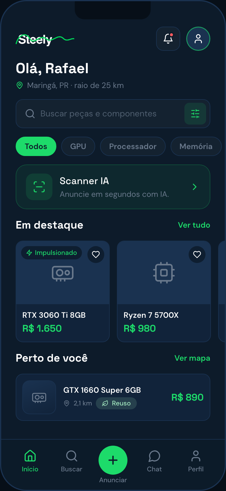
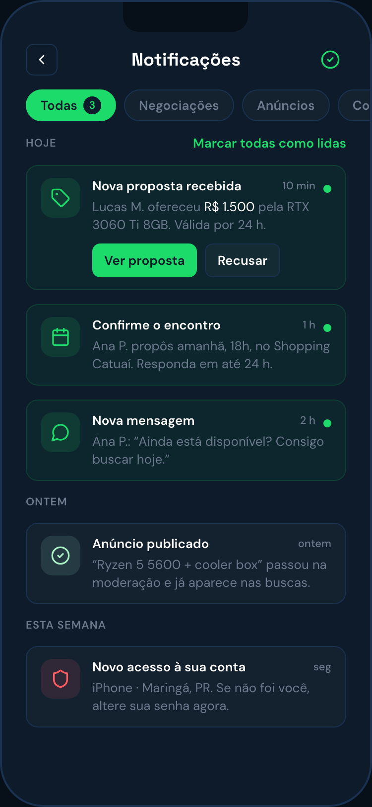
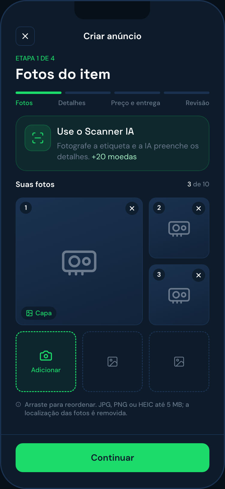
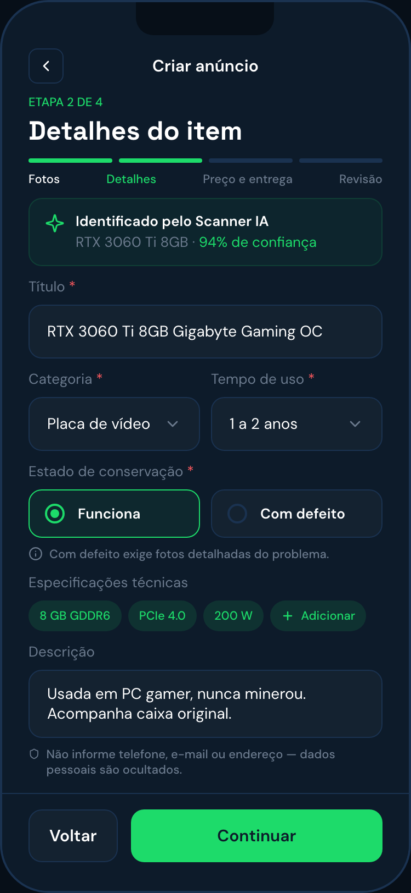
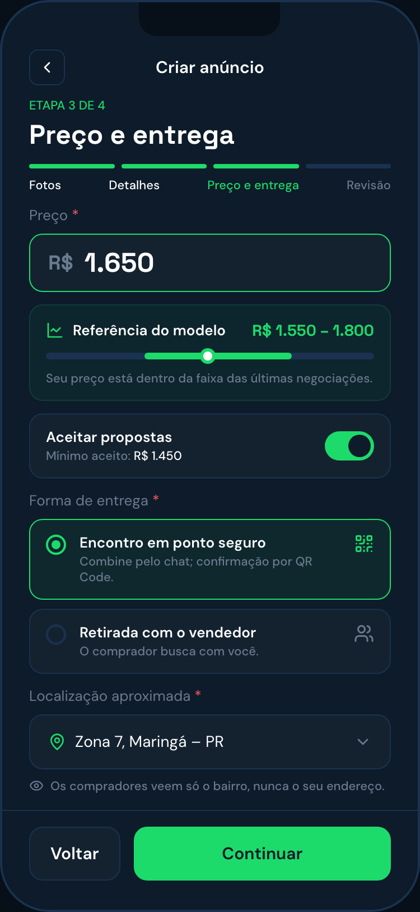
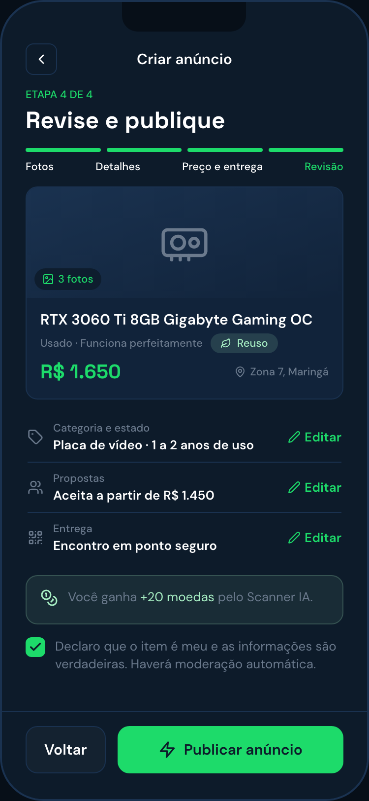

  
  
  
  
  

# 🛠️ Steely — Monorepo de Engenharia, Arquitetura, Banco e Protótipos

> **Disciplina:** Escola de TI · Engenharia de Software · UniCesumar (2026 — **Turma B · Equipe 6**)  
> **Professor:** Enderson Menezes  
> **Status:** Em desenvolvimento (2º semestre de 2026 — Sprints 7–16). Documentação consolidada + Banco Supabase + Protótipos + Backend FastAPI.

O **Steely** é um ecossistema digital web e mobile (Android) para comercialização segura, doação institucional e reciclagem (economia circular) de componentes de hardware de TI. Combina **Visão Computacional (Scanner IA)** para triagem técnica, **gamificação em moedas virtuais** (**Hardware Captcha** e **Laudos Técnicos**), **logística presencial offline-first** validada por **QR Code `Ed25519`** (`≤ 150 ms`), **custódia de 7 dias (*Escrow Simulado*)**, **métricas de impacto ESG** e **inteligência de mercado anonimizada (DaaS com *k-anonimato* `k ≥ 30`)**.

---

## 👥 Equipe de Desenvolvimento

| Integrante | Escopo de Responsabilidade Arquitetural | ADRs sob Responsabilidade |
| --- | --- | --- |
| **Augusto Palma Guglielmi** | Custódia Financeira (*Escrow*), Privacidade/DaaS, Auditoria Imutável, Arbitragem e LGPD | [`ADR-03`](02-adrs/md/ADR-03_Escrow_Simulado.md) a [`ADR-07`](02-adrs/md/ADR-07_Anonimizacao_em_30_Dias_LGPD.md) |
| **Fabrício Notoya Thomas** | Visão Computacional (Scanner IA), Censura Anti-Fuga, Banco de Dados, Autorização, Ledger de Moedas e Mídia | [`ADR-01`](02-adrs/md/ADR-01_Motor_do_Scanner_IA.md), [`ADR-02`](02-adrs/md/ADR-02_Censura_de_Dados_Pessoais_e_Contatos.md) e [`ADR-08`](02-adrs/md/ADR-08_Banco_Principal.md) a [`ADR-12`](02-adrs/md/ADR-12_Limiar_de_Confianca_do_Scanner.md) |
| **Pietro Pasqual Silva** | Arquitetura Frontend Web, Design System/Schemas, Acessibilidade (WCAG 2.1 AA), Captcha e Painel ESG | [`ADR-18`](02-adrs/md/ADR-18_Gerenciamento_de_Estado_e_Dados_no_Cliente.md) a [`ADR-22`](02-adrs/md/ADR-22_Agregacao_de_Metricas_ESG.md) |
| **Rafael Tudela Rizental** | Arquitetura Mobile Android (Expo), Banco Offline-First, Armazenamento Seguro, Push, Mapas/Rotas e Compressão de Imagem | [`ADR-23`](02-adrs/md/ADR-23_Offline_First.md) a [`ADR-27`](02-adrs/md/ADR-27_Captura_e_Compressao_de_Imagem.md) |
| **Thiago Lopes Martins** | Contrato OpenAPI 3.1, Idempotência, Concorrência de Lances, Tarefas Agendadas (`pg_cron`) e Estratégia de Testes/CI | [`ADR-13`](02-adrs/md/ADR-13_Contrato_e_Versionamento_da_API.md) a [`ADR-17`](02-adrs/md/ADR-17_Estrategia_de_Testes.md) |

---

## 🗺️ Mapa de Navegação do Monorepo

| Pasta | Conteúdo |
|---|---|
| [`01-planejamento/`](01-planejamento/README.md) | TAP, Requisitos (`RF-01..21`, `RNF-01..13`), Regras de Negócio, Casos de Uso, DER (66 tabelas), Classes, BPMN e originais (`.pdf`, `.xlsx`, `.docx`, `matrizes/`) |
| [`02-adrs/`](02-adrs/README.md) | Consolidação completa dos **27 ADRs** (`ADR-01` a `ADR-27`) em `.md` e `.pdf` |
| [`03-sdlc-e-governanca/`](03-sdlc-e-governanca/README.md) | Processo SDLC, Backlog/Sprints no Jira (`EDTS`) e Roadmap do Scanner IA |
| [`docs/05-design/`](docs/05-design/README.md) | Manual da marca (`brand-guidelines.pdf`) e protótipos de alta fidelidade (`PROTOTIPAGEM_001..059`) |
| [`docs/historico/`](docs/historico/README.md) | Documentos do 1º semestre (versão anterior do produto) |
| [`supabase/`](supabase/config.toml) | Migrations SQL (`0001` a `0005`), `config.toml` e validadores automatizados |
| [`backend/`](backend/README.md) | Core API — Python 3.12 + FastAPI (`/api/v1`) |
| [`web/`](web/README.md) | Aplicação web — React + Vite |
| [`mobile/`](mobile/README.md) | Aplicativo Android — Expo |
| [`database/`](database/README.md) | Guia de banco de dados |
| [`scanner/`](scanner/README.md) | Scanner IA — visão computacional |
| [`ferramentas/`](ferramentas/verificar_links.py) | Scripts de geração e verificação de telas e links |
| [`site/`](site/README.md) | Site do projeto (GitHub Pages) com cena 3D e protótipos navegáveis |

---

## 🎨 Protótipos de Alta Fidelidade

Protótipos navegáveis da Sprint 13 — [todas as telas](docs/05-design/prototipos/README.md) · [como fazer uma tela nova](docs/05-design/PASSO-A-PASSO-SIMPLES.md) ([guia completo](docs/05-design/GUIA-DE-PROTOTIPOS.md)).

  
  
  
  
  
  

---

## 🏗️ Visão Geral da Arquitetura (Custo R$ 0)

App **Expo** (Android) e SPA **React + Vite** (web) consomem uma API **FastAPI** (Python), que usa **Supabase** (PostgreSQL, Auth, Realtime, Storage) como banco e infraestrutura; o Scanner IA roda como um serviço separado com modelos **ONNX**.

---

## 🤝 Como Contribuir & Linha do Tempo

Veja [CONTRIBUTING.md](CONTRIBUTING.md) para regras de branches (`tipo/EDTS-123-descricao`), Conventional Commits e revisões.

| Período | Produto | Numeração dos documentos |
|---|---|---|
| **1º semestre** (mar–jun/2026, Sprints 1–6) | Plataforma de doação e coleta de sucata eletrônica (Doador, Coletor, Instituição) | `UC-01` a `UC-18`, `RF-01` a `RF-21` |
| **2º semestre** (ago–nov/2026, Sprints 7–16) | Marketplace de hardware com Scanner IA, leilões, moedas e escrow | `STY001` a `STY058`, `RF-01` a `RF-22` (v2.0) |
